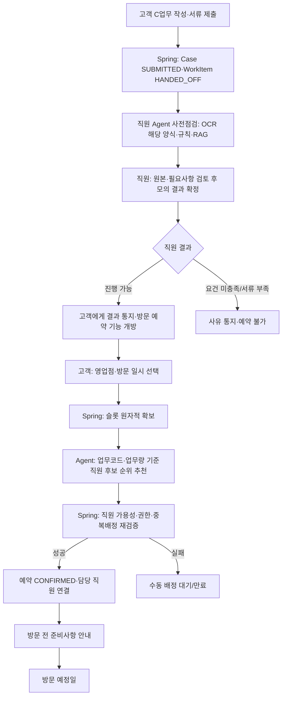

# 기능명세서 — 팀 결정 반영 최종 통합본 v1.7.1 (모의 서명·SOLAPI SMS 인증 보완)

## 변경 이력

| 버전 | 일자 | 내용 |
| --- | --- | --- |
| v1.0 | — | 최초 작성 |
| v1.1 | 2026-10-19 | 업무 요청 기록 페이지(REQ), 알림 페이지(NOTI-11~19), 업무 전환 예외 처리(CHAT-17~19, FLOW-16~25), 대기 사유 `SWITCHED` 추가 |
| v1.2 | 2026-10-19 | ① 공유 자료를 RAG 근거 문서 15개로 정리하고 모든 업무 규칙에 근거(doc_id) 연결 ② 00장 “업무 한눈에 보기” 신설 ③ B-01 규칙 보완(자동 원복, 유의사항 고지) ④ B-02·C-01 세부 기능·규칙·필요서류 신설 ⑤ C-02를 신한 FAQ 원문 기준으로 수정(제적등본 조건, 위임장 접수번호) ⑥ 서류 내용 확인 기능(DOC-14~19) ⑦ 직원 기능(STAFF-14~16) ⑧ RAG 장(15장) 신설 ⑨ Mock 데이터 필드 구체화 |
| v1.3 | 2026-10-19 | **진행 중 업무 전환 폐지**: 진행 중인 업무가 끝나거나 보류될 때까지 다른 업무 요청을 받지 않음(03-2 원칙 2, 03-3). 업무가 끝나거나 보류되면 남은 업무를 번호로 골라 다음 순서를 정함(CHAT-16). 같은 메시지 안 순서 정정 규칙 추가. `SWITCHED`, CHAT-18~19, FLOW-18~22·25 삭제. CHAT-21 입력 잠금, FLOW-26 메시지 순차 처리 추가 |
| v1.4 | 2026-10-19 | 다음 업무는 기본 순서대로 묻고 [예] 다른 업무 선택 [나중에 하기]로 선택(CHAT-16). WorkItem 상태를 `ACTIVE`(입력·동의 대기 포함) / `ON_HOLD`(보류)로 분리하고 `WAITING_USER`·대기 사유 삭제. 상태 전이표 추가. FLOW-27(대기 중 자연어 업무 지정) 추가. 표시 및 삭제 항목(CHAT-18·19, FLOW-18~22·25, DOC-12, STAFF-09) 정리 |
| v1.5 (통합 최종본) | 2026-10-21 | **10/20~10/21 추가 보완안 우선 반영**: 고객·직원 Agent 역할 분리, CLOVA OCR 기반 제출서류 사전점검(STAFF-18), 직원 RAG(STAFF-19), 검토 결과서(STAFF-20), 담당자 추천(STAFF-09), Spring 정형 규칙 검증과 비정형 분석 구분, 접수 후 고객 추가 확인 및 동일 Case 재검증, 최근 7일 채팅 보관·업무 이력 분리, AX 효과 측정. 08·09·10·11·12·13·14·15·17장을 연계 수정. 기존 A/B 기능은 유지. |
| **v1.6** | **2026-10-22** | **방문 영업점 선택 + 방문 시간 예약 + 직원 Agent의 AI 담당자 자동 추천·배정(P0) 추가**. C-02는 제출 시 예약 필수·C-01은 비대면 유지(※ 예약 시점은 v1.7에서 변경). Spring이 영업점/시간별 정원, 직원 가용성·권한·중복 배정을 재검증하고 확정; 실패 시 미확정/수동 배정. 방문 예약과 직원 최종 금융업무 판단은 구분. 새 07-1(VISIT), 직원 STAFF-09, NOTI·SYS·REQ·MOCK·화면·효과 검증, ERD v1.2 연계. |
| **v1.7** | **2026-10-22** | **17-1 팀 결정 18개 항목 전역 반영:** 미제출 업무 3일 미진행 초기화, C업무 직원 검토 후 방문 예약, 제출 후·직원 검토 전 취소, B/C 결과 이메일, 공식 신한은행 양식 한정 OCR, B-01 담보제공자 사례 PoC 비대면 처리, 업무코드·업무량 기반 직원 배정, 미응답 방문 의사 잠정 불참·직원 확인, C-01 ‘방문 전 접수’ 표현, 업무 진술 요약 30일 보관. VISIT/STAFF/DOC/HIST/NOTI/REQ/SYS/AXE 및 상태·시연·예외를 동기화. |
| **v1.7.1 (인증 보완)** | **2026-10-23** | 기존 v1.7 금융업무·Agent·예약 흐름을 유지하면서 B-01/B-02 실행 및 C-01/C-02 최초 제출 직전에 프론트용 모의 서명, Spring 동의 기록, SOLAPI 실제 SMS 인증번호 발송·검증을 추가. SMS는 휴대전화 소지 확인이며 실제 은행 실명확인·법적 전자서명이 아님. 상세 시도/만료 정책은 [제안]으로 구분. |

**반영 기준:** 본 문서는 v1.6 전체 기능을 보존하되 **17-1 팀 결정(2026-10-22)을 우선 적용**한다. 기존 v1.6의 ‘고객 제출 전에 지점/시간을 선택하고 제출과 동시에 슬롯을 확보한다’는 흐름은 **폐기**한다. C-02 고객은 **업무 접수 → 직원 사전검토 결과 통지 → 결과가 ‘진행 가능’일 때 영업점·방문 시간 선택 → AI 추천 및 Spring 예약 확정** 순서로 진행한다. C-01은 비대면 접수를 기본으로 하되, 방문 안내·예약이 필요한 경우 직원 검토 결과 이후 같은 예약 흐름에 진입할 수 있다. 실제 은행 예약·법정 신청/결정 시스템과 연결하지 않는 합성 데이터 기반 PoC다.

**용어·효과의 경계:** 팀에서는 C-01을 ‘방문 전 정식 업무 접수’로 부르기로 정했다. 이는 **제품 UI상의 접수 처리 의미**이며 실제 금융회사의 법정 채무조정 신청이 유효하게 접수되었다는 증명이나 법정 심사·통지를 구현했다는 뜻은 아니다. 직원의 `진행 가능`도 방문 준비 및 추가 절차 안내를 허용하는 **모의 업무 검토 결과**이지, 예금 지급·채무조정 계약의 최종 승인과 동일하지 않다.

**팀 결정 문구 중 안전한 구현 해석:** (①) 3일 미진행 `초기화`는 **미제출 업무의 임시 입력·파일을 초기화하고 재작성하게 하는 처리**로 반영하며, 제출된 Case·법정 기록·감사 로그를 삭제하지 않는다. (②) 방문 여부 확인 미응답 시 ‘불참’ 처리는 **예약·준비서류 계획을 위한 잠정 불참(`UNCONFIRMED_ABSENT`)**으로 표시하고 확정 진술이나 법적 판단으로 저장하지 않는다. (③) 예약의 ‘하루 전까지 변경/취소 가능’은 **방문 예정 시각 24시간 전까지 허용**하는 모의 정책으로 표현한다. 이 세부 해석은 실제 영업점 정책이 아니다.

**표기**

- 구현 영역: FE(Frontend) / BE(Backend) / AI(AI Agent)
- `[제안]` 기본값, 팀 합의로 변경 가능 / `[확인 필요]` 결정 또는 원본 확인 필요 (17장에 모음)
- **근거** 칸의 `CM-01 §11` 같은 표기는 RAG 근거 문서의 doc_id와 절이다. 문서 목록은 `rag_00_문서목록.md`.

---

## 00. 업무 한눈에 보기

### 00-1. A/B/C를 나누는 기준

A/B/C는 영업점 방문 여부가 아니라 **“결과를 누가 정하는가”**로 나눈다.

| 구분 | 결과를 정하는 주체 | 시스템이 하는 일 | AI가 하지 않는 일 |
| --- | --- | --- | --- |
| A 조회 | 정할 결과 없음 | 조건 추출 → 조회 → 설명 | 데이터 변경 |
| B 자동처리 | **Java 규칙** | 규칙 판정 → 고객 확인 → Mock 데이터 변경 | 판정, 직접 변경 |
| C 직원 검토 | **직원** | 고객 Agent의 종류·개수 중심 접수 → 직원 Agent의 OCR·비정형 점검 → Spring 정형 검증 → 직원의 최종 판단 | 직원 대신 서류 진위·법적 권리·채무조정 가부를 확정하거나 최종 승인 |

### 00-1-1. C업무 고객 Agent·직원 Agent 역할 분리 (v1.5)

| 구분 | 입력 | 수행 범위 | 완료 기준 |
| --- | --- | --- | --- |
| 고객 Agent | 고객 발화, 화면 입력, 파일 업로드 정보 | 업무 분류·조건 질문·필요서류 안내, 파일 형식·종류·개수 및 제출 대상자 충족 여부 확인. **업로드된 원문 내용의 의미적 검토는 수행하지 않음** | 고객이 검토 요청을 명시적으로 제출 |
| 직원 Agent | 제출 완료된 ServiceCase, 업무 관련 요약 스냅샷, 검수된 신한은행 공식 양식·일반 서류의 제출 메타 | **공식 양식에 한해** OCR·LLM 추출 → Spring 검증 Tool → 고객 입력/진술 의미 비교 → RAG 근거 조회 → 확인 요청 → 결과서 준비 | 직원이 최종 판단할 수 있도록 점검 결과와 미해결 쟁점 제공 |
| Spring Boot | 정형 입력·OCR 추출값·서류 메타데이터·업무 상태 | 권한·저장·정형 검증·Case 상태·재검증·업무 이력 및 도구 호출 통제 | 검증 결과와 상태를 일관되게 관리 |
| 담당 직원 | 사전접수 담당 권한 또는 예약 영업점 소속, 원본 서류, 점검 근거, 확인 필요 항목 | 원본·진위·권리관계·변제능력·예외사항 판단, 최종 결과 등록 | 책임 있는 직원 판단 종료 |

**v1.7 방문 처리 확정:** 고객 Agent는 C업무 접수 준비를 지원한다. **C-02 방문 지점·시간 선택은 제출 단계가 아니라 직원의 서류 검토 `진행 가능` 결과를 통지한 이후**에 수행한다. C-01은 접수 단계에서 비대면 기본 방식으로 진행하며 방문 안내가 필요한 경우에만 검토 결과 후 예약한다. 직원 Agent는 예약 요청 시 해당 업무 코드·소속 지점·방문시간·현재 업무량 조건을 활용해 가용 직원을 추천한다. **Spring이 검토 결과의 예약 가능 여부 및 슬롯·추천 직원의 가용성·권한을 다시 확인한 뒤 예약과 배정을 확정**한다. 자동 배정 불가 시 직원 수동 배정 대상으로 보낸다. 이는 사전점검(STAFF-18~22)과 별도 작업이며 최종 금융업무 판단 권한을 추가하지 않는다.

**업무 효율 기준선(모의 환경의 가정)**: 직원은 Case 화면에서 입력정보와 제출서류를 직접 열어 검토할 수 있으며, 정형 검증과 Case 조회는 Agent 없이도 Spring이 제공한다. 직원 Agent 도입 성과는 이 기본 기능과 별도로 검증한다. 실제 신한은행 내부 시스템의 수작업 수준을 단정하지 않는다.

### 00-2. 6개 업무

| ID | 업무 코드 | 업무 | 쉬운 설명 | 실제 신한 채널 | 근거 |
| --- | --- | --- | --- | --- | --- |
| A-01 | `TRANSACTION_SEARCH` | 거래내역 조회 | 내 계좌에서 조건에 맞는 거래를 찾아준다 | 비대면 가능 | — |
| A-02 | `LOAN_INQUIRY` | 대출계좌 정보 조회 | 내 대출의 잔액·금리·연체 상태를 보여준다 | 비대면 가능 | — |
| B-01 | `REPAYMENT_ORDER_CHANGE` | 채무변제 충당순서 변경 | 연체된 대출에 돈을 갚을 때 **이자보다 원금이 먼저 빠지도록** 순서를 바꾼다 | **영업점 방문** | CM-01 §11 |
| B-02 | `HOUSING_SAVINGS_CLOSE` | 청년 주택드림 청약통장 해지 | 통장을 해지하면서 **어떤 이율(우대 4.5% 또는 기존 이율)을 받는지** 정한다 | **영업점만 가능** | B02-01 계약의해지 |
| C-01 | `DEBT_ADJUSTMENT` | 채무조정 접수 | 연체 중인 고객이 은행에 **상환 조건을 바꿔 달라고 요청**한다. 은행이 심사한다 | **슈퍼SOL 비대면 가능** | C01-01 요청방법 |
| C-02 | `INHERITANCE_DEPOSIT` | 상속예금 해지·지급 | 돌아가신 분의 예금을 **상속인이 찾는다** | 영업점 방문 원칙 | C02-01 |

**발표·문서 표기 원칙**: B-01, B-02는 실제로 영업점에서만 처리하는 업무다. 이 프로젝트에서는 “규칙이 명확한 영업점 업무를 비대면으로 처리한다면”이라는 **가정 시나리오**로 표기한다. C-01은 신한이 실제로 비대면 신청을 운영하는 업무다.

### 00-3. 헷갈리기 쉬운 두 업무

|  | B-01 충당순서 변경 | C-01 채무조정 신청 |
| --- | --- | --- |
| 무엇을 바꾸나 | 갚은 돈이 **빠지는 순서** (비용→이자→원금 ⇒ 비용→원금→이자) | **상환 조건 자체** (만기연장, 분할상환 유예, 상환방식 변경, 금리인하) |
| 대상 | 기한의 이익이 상실된 대출 | 계좌별 대출원금 3천만원 미만, 연체 중인 대출 |
| 누가 정하나 | 규칙 (조건만 맞으면 바로 변경) | 은행 심사 (거절될 수 있음) |
| 법적 근거 | 상품설명서·여신약관 | 개인채무자보호법 제35조 |
| 근거 문서 | CM-01, B01-01 | C01-01 ~ C01-05 |

같은 연체 대출이 두 업무 모두에 해당할 수 있다. “연체된 대출 충당순서 바꾸고 채무조정도 신청할게요” 요청 하나로 B(즉시 처리)와 C(직원 이관)가 갈라지는 것을 시연할 수 있다.

### 00-4. 용어

| 용어 | 뜻 | 근거 |
| --- | --- | --- |
| 기한의 이익 | 약속한 만기까지 대출금을 갚지 않아도 되는 권리 | CM-01 부록 |
| 기한의 이익 상실 | 연체 등으로 그 권리를 잃은 상태. 대출금 전체를 바로 갚아야 하고, **대출원금 전체에 연체이자**가 붙는다. 예: 이자를 1개월 넘게 안 냄, 분할상환금을 2회 연속 안 냄 | CM-01 §8 가 |
| 충당순서 | 고객이 일부만 갚았을 때 그 돈을 비용·이자·원금 중 무엇부터 갚는 데 쓰는지의 순서 | B01-01 |
| 우대이율 | 청년 주택드림 청약통장에서 조건을 갖추면 주는 높은 이율(최대 연 4.5%) | B02-01 적용이율 |
| 무주택 입증 | 가입 기간에 주택이 없었음을 지방세 세목별 과세증명서로 증명하는 것 | B02-01 이율 자격 입증서류 |
| 채무조정 요청권 | 연체한 채무자가 은행에 채무조정을 요청할 수 있는 법적 권리 | C01-01 |
| 대습상속 | 상속인이 먼저 사망해 그 자녀 등이 대신 상속하는 것 | C02-01 (용어 정의는 원문에 없음) |

---

## 01. 사용자 및 인증 관리 (AUTH)

| 기능 ID | 세부 기능명 | 기능 설명 | 구현 영역 |
| --- | --- | --- | --- |
| AUTH-01 | 사용자 로그인 | DB에 사전 등록된 고객 및 직원 계정의 아이디와 비밀번호를 검증하고 로그인 처리 | FE/BE |
| AUTH-02 | 로그아웃 | 사용자의 로그인 인증 정보를 무효화하고 로그인 화면으로 이동 | FE/BE |
| AUTH-03 | 로그인 상태 확인 | 페이지 새로고침 또는 재접속 시 유효한 로그인 상태인지 확인 | FE/BE |
| AUTH-04 | 사용자 역할별 화면 접근 | 고객과 직원을 구분해 역할별 메인 화면으로 이동하고 허용된 화면만 접근. 업무 요청 기록·알림 페이지는 고객 역할만 접근 | FE/BE |
| AUTH-05 | 인증 만료 처리 | 인증이 만료되거나 유효하지 않을 경우 재로그인 안내 및 보호된 기능 접근 제한 | FE/BE |

**구현 제외**: 회원가입, 비밀번호 찾기 및 재설정, 소셜 로그인, 실제 은행의 실명확인·금융거래 본인확인 절차 및 법적 전자서명, 직원 계정 등록 및 관리 화면. 다만 본 PoC의 B/C 업무 제출·실행을 위한 SOLAPI 문자 인증번호 발송 및 휴대전화 소지 확인은 구현 범위에 포함한다.

**확정 사항**: 회원가입은 구현하지 않고 사전 생성된 테스트 계정을 사용한다.

### 01-1. B/C 공통 동의·모의 서명·SOLAPI SMS 인증 (v1.7.1 추가)

**적용 대상**: B-01 충당순서 변경 실행 직전, B-02 청약통장 해지 실행 직전, C-01 채무조정 모의 접수 제출 직전, C-02 상속예금 모의 사전검토 접수 제출 직전. A-01/A-02 조회, 직원 검토 결과 확정, C업무 사후 방문 예약에는 자동으로 적용하지 않는다. 동일 Case의 고객 추가 확인·서류 보완에 다시 SMS를 요구할지는 별도 정책으로만 추가한다.

**확정 취지**: 디자인 시안의 프론트 전용 모의 서명 UI를 유지하고 SOLAPI(CoolSMS)를 이용한 실제 SMS 인증번호 발송·검증을 구현한다. 서명 이미지나 획 데이터는 서버에 저장하지 않는다. 인증 자체를 은행 실명확인·계약 체결을 위한 법적 전자서명이라고 표현하지 않는다. B-01/B-02의 비대면 자동처리는 여전히 프로젝트의 가정 시나리오이고, C-01/C-02는 직원의 후속 검토·판단이 별도로 필요하다.

| 기능 ID | 기능 | 요구사항 및 책임 | 구현 영역 |
| --- | --- | --- | --- |
| SIGN-01 | 동의 및 안내사항 표시 | 업무별 대상·변경 전후 정보·필수 고지·약관 버전 표시. 필수 동의 항목은 업무별 정책에 맞게 분리 | FE/BE |
| SIGN-02 | 프론트용 모의 서명 | 전용 화면에서 서명 UI 완료 여부 표시. 필기 획·서명 이미지 서버 전송·저장 금지, 법적 서명 효력 표시 금지 | FE |
| SIGN-03 | 동의 기록 | Spring이 인증된 사용자, WorkItem, 동의 유형·공지 버전·동의 시각을 consent_record에 기록하고 실행·제출 직전 확인 | BE |
| SMS-01 | 인증 대상·번호 확인 | Spring에서 로그인 고객과 WorkItem 소유권 검증. 등록된 테스트 계정의 휴대전화번호만 사용하고 화면에는 마스킹하여 표시 | FE/BE |
| SMS-02 | 인증번호 발송 | Spring에서 일회용 인증번호 생성 후 SOLAPI 서버 API로 실제 문자 발송. API 키·발신번호는 서버 환경 변수/비밀값 관리 | BE/외부서비스 |
| SMS-03 | 인증번호 입력·검증 | 사용자가 받은 번호를 입력하면 Spring이 서버에서 검증. React 또는 LangGraph가 번호의 정답을 판정하지 않음 | FE/BE |
| SMS-04 | 유효기간·횟수 제한 | 일회용 인증번호 만료, 시도 횟수 제한, 재발송 간격, 사용자·번호별 발송량 제한. 예: 만료 3분, 검증 5회, 재발송 60초 [제안] | BE |
| SMS-05 | 특정 행위에 인증 묶기 | 인증 성공을 고객 ID·WorkItem ID·업무 액션(예: B01_EXECUTE/C02_SUBMIT)·요청 버전에 바인딩. 다른 업무·타 사용자·이전 버전·만료된 인증으로 실행 금지 | BE |
| SMS-06 | 실행 직전 재검증 및 일회성 소비 | Spring이 동의·SMS 인증·업무 규칙·상태·멱등키를 다시 확인하고, 인증 근거의 재사용을 막으며, 그 뒤 B 실행 또는 C 제출을 트랜잭션 처리 | BE |
| SMS-07 | 실패·장애 처리 | 오입력·만료·재발송 제한·발송 실패·서비스 장애 시 오류 안내. 실제 발송 실패를 인증 성공으로 우회하거나 B/C를 실행하지 않음 | FE/BE |
| SMS-08 | 민감정보 보호·감사 | 인증번호와 인증키를 채팅·RAG·LLM 프롬프트·로그·Git에 노출 금지. 성공 여부와 업무 연결·시각·시도 이력 등 최소 정보만 감사 기록 | BE |
| SMS-09 | 개발·테스트 대체 | CI·자동 테스트에서는 SOLAPI 실제 발송 없이 모의 SMS 송신기 사용. 실제 문자 발송은 별도 환경에서 제한된 테스트 번호로 검증. 운영 환경에서 자동 Mock 우회 금지 | BE |

**B/C 실제 처리 순서**: 업무별 입력·규칙 안내 → 필수 동의 확인 → 프론트 모의 서명 → SMS 인증번호 발송·입력·검증 → Spring의 동의/인증·업무 조건·버전 재검증 → B-01/B-02 Mock 금융 데이터 변경 또는 C-01/C-02 ServiceCase SUBMITTED → 기존 결과·이메일·직원 검토 흐름. 프론트 버튼 잠금은 사용자 경험용이고 서버 검증을 대체하지 않는다.

**데이터 경계**: 기존 user.phone은 테스트 고객의 등록 전화번호, consent_record는 명시적 동의 내역, event_log는 최소 인증 시도·결과 이력의 활용 후보다. OTP 원문은 로그·DB에 저장하지 않고 Redis 등 단기 보관소에 해시 또는 검증 가능한 보호값으로 만료 관리한다. 기존 32개 테이블에는 SMS 전용 Challenge·검증 토큰 구조가 없으므로, 필요한 데이터 구조는 구현 전 기존 DDL과 비교해 두 사람이 합의한 뒤 결정한다. 이 보완 문서는 DB 테이블 신설을 자동 승인하지 않는다.

**법적·업무 범위**: 본 인증은 PoC 테스트 계정의 문자 수신 가능 여부를 확인하는 절차일 뿐 실제 은행의 신원확인, 실명확인, 법적 전자서명, 추가 상속인 동의·위임을 충족한다는 뜻이 아니다. C-01 직원 판단 이후 실질적인 채무조정 계약·고객 최종 동의도 여전히 범위 밖이다.

---

## 02. AI 채팅 (CHAT)

| 기능 ID | 세부 기능명 | 기능 설명 | 구현 영역 |
| --- | --- | --- | --- |
| CHAT-01 | 새 대화 생성 | 고객이 새로운 AI 채팅을 시작 | FE/BE |
| CHAT-02 | 메시지 송수신 | 고객 메시지를 전송하고 AI 응답 표시 | FE/BE/AI |
| CHAT-03 | 금융업무 의도 분석 | 자연어 요청에서 수행하려는 금융업무 식별, 명시적 처리 순서도 분석. “충당순서 변경”과 “채무조정”을 구분 (00-3). 같은 메시지 안의 순서 정정 반영 (03-2) | AI |
| CHAT-04 | 요청 정보 추출 | 계좌와 조회 기간 및 금융업무 처리에 필요한 조건 추출 | AI |
| CHAT-05 | 추가 질문 생성 | 필요한 정보가 부족하거나 요청이 모호한 경우 추가 질문 | AI |
| CHAT-06 | 금융업무 안내 | 수행할 업무와 진행 방법을 자연어로 안내. 업무 설명은 RAG 근거 문서에서 찾은 내용으로만 하고 출처를 함께 표시 (RAG-04) | AI |
| CHAT-07 | 업무 처리 결과 표시 | 조회 결과와 자동처리 결과 및 직원 접수 결과 표시 | FE/BE/AI |
| CHAT-08 | 업무 페이지 이동 안내 | B/C 업무 전용 페이지 링크 또는 이동 버튼 표시 | FE/BE/AI |
| CHAT-09 | 채팅 복귀 후 대화 재개 | 전용 페이지에서 돌아오면 진행 상태를 확인하고 다음 업무 질문(CHAT-16) 표시 | FE/BE/AI |
| CHAT-10 | 미지원 업무 안내 | 등록되지 않은 금융업무 요청 시 지원 불가 안내 | BE/AI |
| CHAT-11 | 대화 문맥 유지 | 이전 대화의 질문과 답변을 참고해 후속 요청 이해 | BE/AI |
| CHAT-12 | AI 응답 상태 및 오류 안내 | 응답 생성 중 표시와 오류 발생 시 재시도 안내 | FE/BE |
| CHAT-13 | 채팅방 목록 조회 및 선택 | 고객이 생성한 채팅방 목록을 조회하고 원하는 채팅방 선택 | FE/BE |
| CHAT-14 | 기존 채팅방 재진입 | 선택한 채팅방의 최근 7일 대화와 업무 상태 복원. 미제출 ACTIVE/ON_HOLD 업무는 **마지막 활동 후 3일 경과 시 임시 입력이 초기화됨**을 안내. 제출된 Case·직원 결과는 유지 | FE/BE |
| CHAT-15 | 보류 업무 이어하기 안내 | 복합 요청의 A와 모든 B/C 보류(`ON_HOLD`) 업무 재개 지원 | FE/BE/AI |
| CHAT-16 | 다음 업무 질문 | 업무가 끝나거나 보류되면 “다음으로 {업무}를 진행할까요?” [예] [다른 업무 선택] [나중에 하기] 표시. 2개 이상 업무를 요청한 경우에도 **고객 확인 후 다음 업무를 시작**하며 자동 실행하지 않음 | FE/BE/AI |
| CHAT-17 | 진행 중 다른 업무 요청 안내 | 업무 진행 중 다른 업무를 요청하면 새 업무를 만들지 않고 고정 문장 + [보류하고 다음 업무로] [계속 진행] 버튼 표시 (03-3) | FE/BE/AI |
| CHAT-20 | 업무 설명 질문 응답 | “충당순서 변경이 뭐예요?”처럼 업무 자체를 묻는 질문에 RAG 근거로 답하고 출처 표시. 근거가 없으면 모른다고 답하고 영업점 문의 안내 (RAG-06). 업무 진행 중에도 답하고 현재 업무를 계속함 | AI/BE |
| CHAT-21 | 채팅 입력 잠금 | AI 응답 생성 중, B/C 전용 페이지 작업 중에는 채팅 입력창을 막음. 페이지에서는 [완료] 또는 [보류하고 채팅으로]만 가능 | FE/BE |

---

## 03. 복합 업무 및 Workflow 관리 (FLOW)

| 기능 ID | 세부 기능명 | 기능 설명 | 구현 영역 |
| --- | --- | --- | --- |
| FLOW-01 | 복합 업무 분리 결과 수신 | AI가 분석한 업무 목록과 고객이 요청한 처리 순서 수신 | AI/BE |
| FLOW-02 | Workflow 생성 | 하나의 금융업무 요청에 대한 업무 묶음을 생성하고 채팅방에 연결 | BE |
| FLOW-03 | WorkItem 생성 | 분리된 업무마다 고유 ID와 업무 유형을 가진 WorkItem 생성 | BE |
| FLOW-04 | 업무 처리 순서 관리 | 처음 순서(`sequence`)는 고객이 명시한 순서, 없으면 발화 순서. 이후에는 이 순서대로 다음 업무를 묻고, 고객이 다른 업무 선택으로 바꿀 수 있음 | BE |
| FLOW-05 | 업무 상태 관리 | 업무별 진행 상태를 독립적으로 저장하고 변경 | BE |
| FLOW-06 | 업무 보류 | `ACTIVE` → `ON_HOLD`, `resume_step` 저장. **미제출 상태에서 마지막 활동 후 3일 이상 활동이 없으면 임시 입력 초기화 처리(자동 초기화; SYS-20)**. 제출·이관된 C Case에는 미적용 | FE/BE |
| FLOW-07 | 다음 업무 후보 조회 | 다음 질문 대상: `sequence`상 첫 `PLANNED`, 없으면 첫 `ON_HOLD`. 다른 업무 선택 목록: `PLANNED`(sequence 순) → `ON_HOLD`(sequence 순) | BE |
| FLOW-08 | 업무별 실패 처리 | 특정 업무 실패가 다른 업무에 영향 주지 않도록 처리 | BE |
| FLOW-09 | 복합 업무 현황 조회 | Workflow에 포함된 업무별 진행 상태와 처리 결과 제공 | FE/BE |
| FLOW-10 | 보류 업무 재개 | `ON_HOLD` → `ACTIVE` 및 임시 저장값 복원. 다만 **미제출 상태로 3일 미진행하여 초기화된 업무**는 이전 입력을 복원하지 않고 신규 작성 안내 | BE |
| FLOW-11 | 중복 업무 생성 방지 | 같은 업무 요청이나 중복 API 호출로 WorkItem이 중복 생성되는 현상 방지 | BE |
| FLOW-12 | 업무 상태 동기화 | 업무별 상태 변경과 복합 업무 진행 현황 동기화 | BE |
| FLOW-13 | 다음 업무 선택 처리 | 고객이 [예] 또는 [다른 업무 선택]으로 고른 업무만 `ACTIVE`로 변경. 앞 업무 완료만으로 다음 업무를 자동 실행하지 않으며 선택 가능 상태 재확인 | FE/BE/AI |
| FLOW-14 | 복합 업무 진행 일시정지 | [나중에 하기] → 남은 업무 유지, Workflow `PAUSED` | BE |
| FLOW-15 | Workflow 상태 관리 | 복합 업무 전체의 진행 상태 및 완료 여부 관리 (03-1) | BE |
| FLOW-16 | 진행 중 메시지 분류 | `ACTIVE` 업무가 있을 때 고객 메시지를 ① 현재 업무 답변 ② 현재 업무·업무 설명 질문 ③ 보류·취소 요청 ④ 다른 업무 요청 중 하나로 분류해 Backend에 전달. AI는 상태를 바꾸지 않음 | AI |
| FLOW-17 | 진행 중 다른 업무 시작 차단 | Workflow에 `ACTIVE` 업무가 있으면 Spring이 새 WorkItem 생성과 다른 업무의 `ACTIVE` 전이를 거부. AI가 잘못 분류해도 업무가 생기지 않음 | BE |
| FLOW-23 | 단일 ACTIVE 보장 | Workflow 단위로 상태 변경을 직렬화(`version`)해 `ACTIVE` 업무가 2개 생기지 않도록 보장 | BE |
| FLOW-24 | 상태 충돌 처리 | 업무 페이지(다른 탭 포함)에서 저장할 때 업무 상태가 이미 바뀌었으면 저장을 거부하고 최신 상태 안내 | FE/BE |
| FLOW-26 | 메시지 순차 처리 | 한 채팅방의 메시지는 하나씩 차례대로 처리. 처리 중 들어온 메시지는 앞 메시지 처리가 끝난 상태 기준으로 해석 | FE/BE |
| FLOW-27 | 대기 중 자연어 업무 지정 | `ACTIVE` 업무가 없을 때(`WAITING_CONTINUE`·`PAUSED`) 고객이 남은 업무를 말하면(“채무조정 할게”) 다른 업무 선택과 같이 처리. Workflow에 없는 업무면 WorkItem을 추가하고 바로 시작 | AI/BE |
| FLOW-28 | 미제출 업무 3일 미진행 초기화 | 3일(구현 기준 72시간) 이상 활동이 없는 미제출 WorkItem의 임시 입력·업로드 임시 파일을 정리하고 해당 임시 작업을 재작성 상태로 전환. 이미 제출된 Case·검토 이력·예약·금융 원장은 삭제하지 않음. 작업 초기화 이벤트 기록 | BE |

### 03-1. 상태 정의

**WorkItem 상태**

| 상태 코드 | 의미 | 사용 예시 |
| --- | --- | --- |
| `PLANNED` | 생성됐지만 아직 시작하지 않은 업무 | A/B/C 분리 직후 C 업무 |
| `ACTIVE` | 진행 중인 업무 (Workflow당 1개). 고객 입력·동의를 기다리는 동안도 포함. **이 동안 다른 업무 요청은 받지 않음** | 거래내역 조회 계좌 선택 대기 |
| `ON_HOLD` | 고객이 보류한 업무. 진행 단계(`resume_step`)를 저장하고 나중에 이어서 진행 | B 업무 대출 선택 후 보류 |
| `DONE` | A/B 업무 처리 완료 | 거래내역 조회 완료 |
| `HANDED_OFF` | C 업무가 직원 검토용 Case로 이관됨 | C 업무 접수 완료 |
| `FAILED` | 업무 처리 실패 | 업무 실행 오류 |
| `CANCELED` | 고객이 명시적으로 취소한 업무 | 처리 요청 취소 |

**WorkItem 상태 전이**

| 전이 | 계기 |
| --- | --- |
| `PLANNED` → `ACTIVE` | 다음 업무 질문에서 [예] 또는 다른 업무 선택으로 고름 |
| `ACTIVE` → `ON_HOLD` | [보류], [보류하고 다음 업무로], “오늘은 여기까지” |
| `ON_HOLD` → `ACTIVE` | 이어서 진행 (채팅방 재진입, 업무 요청 기록, 다음 업무 질문) |
| `ACTIVE` → `DONE` / `HANDED_OFF` / `FAILED` | 업무 완료 / C 제출 / 오류 |
| `PLANNED`·`ACTIVE`·`ON_HOLD` → `CANCELED` | 고객 취소 확인, 또는 미제출 업무의 3일 미진행 자동 초기화(사유 `AUTO_RESET_3D`, 원래 신청 재작성) |

**Workflow 상태**

| 상태 코드 | 의미 |
| --- | --- |
| `RUNNING` | `ACTIVE` 업무가 있음 → 다른 업무 요청 차단 |
| `WAITING_CONTINUE` | 업무가 끝나거나 보류된 뒤 다음 업무 질문에 대한 응답 대기 |
| `PAUSED` | [나중에 하기] 또는 전체 중단. 남은 업무 유지 |
| `COMPLETED` | 모든 WorkItem이 `DONE`·`HANDED_OFF`·`FAILED`·`CANCELED` 중 하나. `ON_HOLD`가 남아 있으면 완료가 아님 |

**Workflow 상태 전이**

| 전이 | 계기 |
| --- | --- |
| `RUNNING` → `WAITING_CONTINUE` | `ACTIVE` 업무가 끝나거나 보류됨 + 남은 업무 있음 |
| `RUNNING` → `COMPLETED` | 마지막 업무 종료 + 남은 업무 없음 |
| `WAITING_CONTINUE` → `RUNNING` | [예] 또는 다른 업무 선택으로 고름 |
| `WAITING_CONTINUE` → `PAUSED` | [나중에 하기] |
| `RUNNING` → `PAUSED` | “오늘은 여기까지” (현재 업무 `ON_HOLD`) |
| `PAUSED` → `RUNNING` | 남은 업무 이어서 진행 |

**업무 관련 데이터** `[제안: 컬럼명]`

| 컬럼 | 위치 | 용도 |
| --- | --- | --- |
| `sequence` | WorkItem | 처음 정한 순서. 다음 업무 질문의 기준 |
| `resume_step` | WorkItem | `ACTIVE`·`ON_HOLD`의 진행 단계 (예: 대출 선택 완료). 재개 시 복원 |
| `version` | Workflow | 다음 업무 선택·상태 변경 동시 요청 직렬화 (낙관적 락). `ACTIVE` 2개 방지 |

### 03-2. 업무 처리 순서 원칙

1. **처음 순서는 고객의 의도를 따른다**
    - 우선순위 1: 고객이 명시적으로 지정한 순서
    > “채무조정 먼저 신청하고 충당순서 변경한 다음 거래내역 조회해줘.” → C-01 → B-01 → A-01
    - 우선순위 2: 별도 지시가 없으면 언급한 순서
    > “충당순서 변경하고 거래내역 조회하고 채무조정 신청해줘.” → B-01 → A-01 → C-01
    - 우선순위 3: 순서를 판단할 수 없으면 고객에게 확인
    > “거래내역 조회랑 채무조정 신청 둘 다 해야 하는데 뭐부터 하지?”
    - 같은 메시지 안에서 순서를 정정하면 나중 말이 우선한다. 지목한 업무만 앞으로 오고 나머지는 말한 순서를 유지한다.
    > “거래내역 조회하고 충당순서 변경하고 채무조정 신청해줘. 아 근데 채무조정 먼저 할래” → C-01 → A-01 → B-01
    > “세 개 다 해줘, 아 거래내역은 빼고” → 거래내역 WorkItem은 만들지 않음
2. **업무가 끝나거나 보류되면 다음 업무를 묻는다**
    - `sequence`상 다음 `PLANNED` 업무를 묻는다. 남은 `PLANNED`가 없으면 보류한 업무를 이어서 할지 묻는다.
    - 버튼: [예] 다른 업무 선택 [나중에 하기]
    - 
    - [나중에 하기]를 선택해도 나머지 업무는 취소되지 않는다. Workflow는 `PAUSED`.
    - 고객이 브라우저를 종료해도 미제출 업무는 보류 상태로 유지하되 **마지막 활동 후 3일이 지나면 임시 입력을 초기화**한다. 제출된 Case·검토 결과는 초기화 대상이 아니다.
3. **A 업무 보류 범위**
    
    
    | 상황 | 처리 방식 |
    | --- | --- |
    | A 업무만 단독 요청 | 조회 완료 후 종료. 별도의 보류 기능 없음 |
    | 복합 요청에서 A 진행 전 | 다른 업무를 고르면 A는 `PLANNED`로 유지 |
    | 복합 요청에서 A 진행 중 | 조회 조건 입력 등을 보류(`ON_HOLD`)하고 다음 업무로 이동 가능 |
    | 복합 요청에서 A 완료 | 조회 결과 저장 후 다음 업무 질문 |
    | 복합 요청에서 A 보류 후 재개 | 이전 조회 조건과 진행 단계를 불러와 이어서 조회 |
4. **진행 중인 업무는 끝나거나 보류될 때까지 다른 업무 요청을 받지 않는다**
    - 진행 중 = WorkItem `ACTIVE` (고객 입력·동의 대기 포함) = Workflow `RUNNING`
    - AI 응답 생성 중, B/C 전용 페이지 작업 중에는 채팅 입력을 막는다 (CHAT-21).
    - 진행 중에도 현재 업무에 대한 답변·질문·보류·취소는 받는다.
    - Workflow에 `ACTIVE` 업무가 있으면 Spring이 새 WorkItem 생성과 다른 업무 시작을 거부한다 (FLOW-17).

### 03-3. 진행 중 다른 업무 요청 처리

전제: Workflow에 `ACTIVE` 업무가 있는 상태. 입력창을 막는 구간(CHAT-21)에서는 메시지 자체가 오지 않는다.

**고정 안내 문장**

> “지금은 {현재 업무}를 진행 중입니다. 다른 업무는 이 업무를 마치거나 보류한 뒤 진행할 수 있어요.”
[보류하고 다음 업무로] [계속 진행]
> 

| # | 고객 발화 예시 | 상황 | 처리 |
| --- | --- | --- | --- |
| E1 | “잠깐, 채무조정부터 할게” | 같은 Workflow의 다른 업무 요청 | 고정 안내. [보류하고 다음 업무로] → 현재 업무 `ON_HOLD` → 다음 업무 질문(CHAT-16) |
| E2 | “아 그리고 대출 금리도 알려줘” | Workflow에 없는 업무 요청 | 고정 안내. 새 WorkItem은 만들지 않음. 현재 업무가 끝난 뒤 다시 요청 (FLOW-27) |
| E3 | “주택담보대출 되는지 볼게” | 미지원 업무 | CHAT-10 안내 후 현재 업무 계속 |
| E4 | “이 계좌 말고 다른 계좌요”, “충당순서가 뭐예요?” | 현재 업무 답변·질문 | 정상 처리. 현재 업무 계속 |
| E5 | “그거 안 할래”, “취소해줘” | 현재 업무 취소 | 취소 확인 → 확인 시 `CANCELED` → 다음 업무 질문. 보류인지 취소인지 불명확하면 [나중에 하기] [취소하기] 버튼 |
| E6 | “다 그만할게”, “오늘은 여기까지” | 전체 중단 | 현재 업무 `ON_HOLD`, Workflow `PAUSED`. 업무 요청 기록에서 이어하기 가능 |
| E7 | (진행 중 업무 없을 때) 이미 끝난 업무를 다시 요청 | 대상이 `DONE`/`HANDED_OFF` | 처리 결과와 업무 요청 기록 링크 안내. 새로 하려는 것인지 확인 후 신규 WorkItem 생성 (B-01 이미 변경된 대출은 B-R4에서 차단) |
| E8 | (진행 중 업무 없을 때) 다른 채팅방에 작성 중인 같은 C 업무가 있음 | C 중복 접수 | 기존 Case를 이어서 할지 고객에게 질문 |

**AI가 분류를 틀린 경우**

- 답변을 다른 업무 요청으로 잘못 분류 → 고정 안내가 나가고 고객이 [계속 진행]을 누르면 원래대로 진행. 상태는 바뀌지 않는다.
- 다른 업무 요청을 답변으로 잘못 분류 → 현재 업무의 입력 검증(계좌·기간 형식 등)에서 걸려 다시 질문. 새 업무는 FLOW-17 때문에 생기지 않는다.

### 03-4. 시나리오 예시

**예시 1 — 기본 복합 업무**

> “충당순서 변경 먼저 하고 거래내역 조회한 다음 채무조정 신청해줘.”
> 
1. AI가 업무 분리 → B-01 → A-01 → C-01 순서로 Workflow 생성
2. B-01 진행: 고객이 충당순서 변경 페이지로 이동해 처리 (이 동안 채팅 입력 잠금)
3. 채팅방 복귀: “충당순서 변경 업무가 완료되었습니다. 다음으로 거래내역 조회를 진행하시겠습니까?” [예] 다른 업무 선택 [나중에 하기] → [예]
4. A-01 진행: 고객이 계좌를 선택하지 않고 [나중에 처리] → A-01 `ON_HOLD` → “거래내역 조회 업무가 보류되었습니다. 다음으로 채무조정 신청을 진행하시겠습니까?” → [예]
5. C-01 진행: 증빙서류 제출 후 [채무조정 접수] → “채무조정 접수가 등록되었습니다. 직원 검토 결과가 확정되면 웹 알림과 이메일로 안내해 드리겠습니다.” (본 PoC의 모의 업무 접수임을 화면에서 구분)
6. “보류한 거래내역 조회를 이어서 진행하시겠습니까?” [예] [나중에 하기] → [나중에 하기] → Workflow `PAUSED`. 이후 기존 채팅방 또는 업무 요청 기록에서 이어서 진행

**예시 2 — 진행 중 다른 업무 요청**

> “거래내역 조회하고 채무조정 신청해줘.” → A-01, C-01
> 
1. A-01 `ACTIVE`. AI: “어떤 계좌의 거래내역을 볼까요?”
2. 고객: “아 잠깐, 채무조정부터 할게”
3. AI(고정 안내): “지금은 거래내역 조회를 진행 중입니다. 다른 업무는 이 업무를 마치거나 보류한 뒤 진행할 수 있어요.” [보류하고 다음 업무로] [계속 진행]
4. [보류하고 다음 업무로] → A-01 `ON_HOLD` → “다음으로 채무조정 신청을 진행하시겠습니까?” → [예] → C-01 진행
5. C-01 제출 후: “보류한 거래내역 조회를 이어서 진행하시겠습니까?” [예] [나중에 하기]

**예시 3 — 같은 대출에서 B와 C가 갈라짐**

> “연체된 대출 충당순서 원금부터 갚게 바꾸고, 채무조정도 신청하고 싶어요.” → B-01, C-01
> 
1. 고객 대출 중 기한의 이익이 상실된 대출 1건 특정
2. B-01: 규칙 B-R1~R5 통과 → 변경 전후 순서와 유의사항(B01-01) 표시 → 고객 동의 → 즉시 변경 → `DONE`
3. “다음으로 채무조정 신청을 진행하시겠습니까?” [예] → C-01: 요청 가능 규칙 C1-R1~R5 통과 → 요청사유·변제능력 자료 업로드 → [직원 검토 요청] → `HANDED_OFF`
4. 고객 안내: “충당순서는 바로 변경되었습니다. 채무조정은 은행 심사가 필요해 직원 검토 후 안내드립니다.”

**예시 4 — 한 메시지 안에서 순서 정정**

> “거래내역 조회하고 충당순서 변경하고 채무조정 신청해줘. 아 근데 채무조정 먼저 할래”
> 
1. AI가 메시지 전체를 분석 → C-01 → A-01 → B-01 순서로 Workflow 생성
2. C-01부터 진행

---

## 04. 업무 페이지 이동 및 복귀 (NAV)

| 기능 ID | 세부 기능명 | 기능 설명 |
| --- | --- | --- |
| NAV-01 | 업무 페이지 이동 안내 | AI 채팅에서 B/C 업무 전용 페이지 이동 버튼 제공 |
| NAV-02 | 업무 전용 페이지 진입 | 현재 탭에서 해당 업무의 전용 페이지로 이동 |
| NAV-03 | 진행 정보 복원 | 기존 입력 정보와 진행 단계 불러오기 |
| NAV-04 | 업무 정보 임시저장 | B/C 업무의 입력 정보 및 진행 상태 저장 |
| NAV-05 | 업무 보류 후 복귀 | 진행 중인 B/C 업무를 보류(`ON_HOLD`)하고 기존 채팅방으로 이동 |
| NAV-06 | 업무 완료 후 복귀 | B 업무 완료 또는 C 업무 접수 후 기존 채팅방으로 이동 |
| NAV-07 | 채팅 복귀 시 상태 확인 | 해당 업무의 최신 처리 상태 조회 |
| NAV-08 | 다음 업무 안내 | 남아 있는 WorkItem이 있으면 다음 업무 질문(CHAT-16) 표시 |
| NAV-09 | 중단 업무 재진입 | 기존 채팅방 또는 업무 요청 기록 페이지에서 B/C 업무 이어하기 |
| NAV-10 | 잘못된 페이지 접근 처리 | 존재하지 않거나 권한이 없는 업무 접근 차단 |

---

## 05. A 유형 — 금융정보 조회 (A)

### A-01. 거래내역 조회

| 기능 ID | 세부 기능명 | 기능 설명 | 구현 영역 |
| --- | --- | --- | --- |
| A-01-01 | 조회 대상 계좌 확인 | 고객 보유 계좌 조회 및 대상 계좌 식별 | BE/AI |
| A-01-02 | 조회 기간 추출 | 자연어에서 조회 시작일과 종료일 추출 | AI |
| A-01-03 | 상세 거래 조건 추출 | 입출금 구분, 금액 범위, 거래 상대방 또는 적요 추출 | AI |
| A-01-04 | 조회 조건 추가 질문 | 필수 조건이 부족하거나 모호하면 추가 질문 | AI |
| A-01-05 | 거래내역 조회 실행 | Backend에서 여러 검색 조건을 조합해 조회 | BE |
| A-01-06 | 거래내역 결과 표시 | 조회 결과를 채팅 내 표 또는 카드로 표시 | FE/AI |
| A-01-07 | 조회 결과 없음 안내 | 일치하는 거래내역이 없는 경우 안내 | FE/AI |
| A-01-08 | 조회 조건 오류 처리 | 잘못된 기간이나 허용 범위를 초과한 조회 요청 처리 | BE |

### A-02. 대출계좌 정보 조회

| 기능 ID | 세부 기능명 | 기능 설명 | 구현 영역 |
| --- | --- | --- | --- |
| A-02-01 | 대출계좌 목록 조회 | 고객이 보유한 대출계좌 목록 조회 | BE |
| A-02-02 | 조회 대상 대출 확인 | 자연어에서 특정 대출 식별 및 여러 대출이 있는 경우 선택 안내 | AI/FE |
| A-02-03 | 요청 정보 추출 | 고객이 조회하려는 대출정보 항목 추출 | AI |
| A-02-04 | 대출계좌 상세 조회 | 선택한 대출의 상세 금융정보를 Backend Tool로 조회. 연체 일수, 기한의 이익 상실 여부, 현재 충당순서 포함 (B-01, C-01 진입 전 확인용) | BE |
| A-02-05 | 대출정보 결과 표시 | 대출계좌 정보 및 조회 결과를 채팅에 표시 | FE/AI |
| A-02-06 | 대출계좌 없음 안내 | 고객 명의의 대출이 없거나 조회 결과가 없는 경우 안내 | FE/AI |
| A-02-07 | 조회 오류 처리 | 존재하지 않거나 조회할 수 없는 대출계좌 요청 시 오류 안내 | FE/BE |

---

## 06. B 유형 — 조건 기반 자동처리 (B)

### B-01. 채무변제 충당순서 변경

**업무 설명**

- 기한의 이익이 상실된 대출은 대출원금 전체에 연체이자가 붙는다 (CM-01 §8 가).
- 기본 충당순서는 **비용 → 이자 → 원금**이다. 연체금을 전부 갚을 수 없는 고객이 일부만 갚으면 돈이 이자부터 빠져 원금이 줄지 않는다.
- 순서를 **비용 → 원금 → 이자**로 바꾸면 원금을 먼저 줄여 연체이자가 붙는 원금 잔액을 낮출 수 있다 (B01-01 유의사항).
- 단점도 있다. 남은 원금에는 계속 연체이자가 붙고, 연체정보 등록과 법적절차는 변경 전과 똑같이 적용된다 (B01-01 기타 확인사항).
- 실제로는 영업점 방문 신청 업무다 (CM-01 §11). 이 프로젝트에서는 비대면 가정 시나리오로 처리한다.

**적격 규칙** — Java로 판정

| 규칙 | 조건 | 결과 코드 | 근거 |
| --- | --- | --- | --- |
| B-R1 | 기한의 이익이 상실되지 않은 대출 | `NOT_ACCELERATED` | CM-01 §11 채무변제충당순서 변경 신청 |
| B-R2 | 외부기관 위탁대출 | `OUTSOURCED_LOAN` | CM-01 §11 |
| B-R3 | 협약대출 | `AGREEMENT_LOAN` | CM-01 §11 |
| B-R4 | 현재 충당순서가 이미 비용→원금→이자 | `ALREADY_CHANGED` (되돌리는 재변경은 영업점 안내) | CM-01 §11, B01-01 |
| B-R5 | 위에 해당 없음 | `ELIGIBLE` | — |

**자동 원복** (B01-01 채무변제충당순서의 자동 변경)

변경 후 아래 사유가 생기면 별도 신청 없이 순서가 **비용→이자→원금**으로 돌아간다. B-R4는 변경 이력이 아니라 **현재 충당순서 값**으로 판정한다.

1. 연체된 이자·분할상환원(리)금 등을 전액 상환해 기한의 이익이 자동 부활한 경우
2. 만기가 지난 대출의 기한을 연장한 경우
3. 그 밖의 사유로 상실됐던 기한의 이익이 부활한 경우

PoC에서는 Mock 이벤트(MOCK-12)로 위 사유를 발생시켜 `loan.repayment_order`와 `loan.acceleration_declared`를 함께 되돌린다. 되돌아간 대출은 B-R1(기한의 이익 상실 아님)에 걸린다.

**세부 기능**

| 기능 ID | 세부 기능명 | 기능 설명 | 구현 영역 |
| --- | --- | --- | --- |
| B-01-01 | 대상 대출계좌 조회 | 고객 명의 대출계좌 목록 조회 | FE/BE |
| B-01-02 | 변경 대상 대출 선택 | 충당순서를 변경할 대출계좌 선택 | FE |
| B-01-03 | 변경 가능 조건 검증 | B-R1~R5 판정. 담보제공자·연대보증인 관련 Mock 플래그가 있어도 프로젝트의 비대면 가정 시나리오에서는 자동 제외하지 않음. **실제 필수 서명·동의를 확인했다고 주장하지 않고 별도 직원 확인 주의 표시** | BE |
| B-01-04 | 검증 결과 안내 | 변경 가능 여부와 변경 불가 사유 표시. 사유 문장은 근거 문서 조항과 함께 표시 | FE/BE |
| B-01-05 | 변경 전후 충당순서 표시 | 현재 충당순서와 변경 예정 순서 표시 | FE/BE |
| B-01-06 | 고객 동의 확인 | 고객이 변경 내용을 확인하고 명시적으로 동의. SIGN-01~03, SMS-01~08을 변경 실행 직전 적용 | FE/BE |
| B-01-07 | 변경 조건 재검증 | 변경 실행 직전 최신 대출 상태 및 조건 재확인 | BE |
| B-01-08 | 충당순서 변경 실행 | 검증 통과 시 Mock 대출정보의 충당순서 변경 | BE |
| B-01-09 | 변경 이력 저장 | 변경 전후 값, 고객 확인 시각, rule_version, 처리 결과 기록 | BE |
| B-01-10 | 처리 결과 안내 | 성공·실패 등 처리 결과를 화면에 표시하고 기존 채팅으로 복귀. **B업무 완료 결과 이메일**(NOTI-24) 발송 | FE/BE |
| B-01-11 | 유의사항 고지 | 동의 전 B01-01 유의사항 원문 표시: 잔여 원금 연체이자 계속, 연체정보 등록·법적절차 동일, 자동 원복 사유, 되돌리는 재변경은 영업점 | FE/BE |
| B-01-12 | 자동 원복 반영 | 자동 원복 이벤트 발생 시 충당순서를 되돌리고 이력 기록 | BE |

**동의 화면 문구**: B01-01 “신청인 확인 문구”를 기준으로, 사본 수령 관련 문장은 빼고 “유의사항을 확인했습니다”로 쓴다 `[제안]`.

### B-02. 청년 주택드림 청약통장 해지

**업무 설명**

- 청년 주택드림 청약통장은 조건을 갖추면 최대 연 4.5%의 우대이율을 준다 (B02-01 상품 개요).
- 해지할 때 시스템이 정해야 하는 것은 **“어떤 이율표를 적용하는가”**다. 해지 자체는 가능하지만 이율이 달라진다.
- 우대이율을 받으려면 가입 기간에 무주택이었음을 「지방세 세목별 과세증명서」로 증명해야 한다 (B02-01 이율 자격 입증서류).
- 실제로는 **영업점에서만 해지 가능**하다 (B02-01 계약의해지). 비대면 가정 시나리오로 처리한다.

**이율표** (B02-01, 세전·단리, 변동금리)

| 가입기간 | 기존 청약통장 이율 | 청년주택드림 이율 |
| --- | --- | --- |
| 1개월 이내 | 무이자 | 무이자 |
| 1개월 초과 1년 미만 | 연 2.3% | 연 3.7% |
| 1년 이상 2년 미만 | 연 2.8% | 연 4.2% |
| 2년 이상 10년 이내 | 연 3.1% | 연 4.5% |
| 10년 초과 | 연 3.1% | 연 3.1% |

**판정 규칙** — Java로 판정. 결과는 “적용 이율표”이며 이자 금액은 계산하지 않는다 `[제안]`.

| 규칙 | 조건 | 결과 코드 | 근거 |
| --- | --- | --- | --- |
| B2-R1 | 가입기간 1개월 이내 | `NO_INTEREST` (무이자) | B02-01 이율표 |
| B2-R2 | 가입 2년 미만 + 청약당첨 해지 아님 | `BASE_RATE` (기존 이율) | B02-01 이율 한도 및 적용기간, B02-02 각서 유의사항 3 |
| B2-R3 | 고객이 우대이율 포기에 동의 | `BASE_RATE` | B02-01 유의사항, B02-02 동의서 |
| B2-R4 | 가입 2년 이상 또는 청약당첨 해지 → 과세증명서상 **과세사실 없음** | `PREFERRED_RATE` (청년주택드림 이율) | B02-01 이율 자격 입증서류 ① |
| B2-R5 | 가입 2년 이상 또는 청약당첨 해지 → 과세증명서상 **과세사실 있음** | `MANUAL_REVIEW` (자동 판정 불가) | B02-01 ②③, 무주택 판단기준 |
| B2-R6 | 가입 2년 이상 또는 청약당첨 해지 → 과세증명서 미제출 | 제출 요청 또는 B2-R3 선택 안내 | B02-01 |
- **B2-R5가 자동 판정 불가인 이유**: 과세사실이 있어도 가입 전 매도, 명의 불일치, 무주택 판단기준 10가지 예외에 해당하면 무주택으로 인정된다. 가입 중 주택을 취득했다면 취득 연도의 직전년도 말까지만 무주택 기간이다. 이 판단은 등기부등본 등 추가 서류를 사람이 봐야 한다.
- B2-R5의 처리: PoC 기본은 **“영업점 상담 필요” 안내 후 종료** `[제안]`. 직원 검토 Case로 넘기는 것은 확장 과제로 둔다 `[확인 필요]`.

**범위 밖** (안내만 하고 처리하지 않음)

| 상황 | 이유 | 근거 |
| --- | --- | --- |
| 가입자 사망으로 상속인이 해지 | 상속인 기준으로 이율 조건 적용 | B02-01 기타 유의사항 |
| 상계, 추심명령·전부명령에 따른 해지 | 별도 절차 | B02-01 기타 유의사항 |
| 전환신규 계좌의 전환원금 | 우대이율 미적용 원금 구분 필요 | B02-01 이율 한도 |
| 2년 미만 해지의 비과세 추징 면제 (특별해지사유) | 확장 과제 | B02-01 비과세 요건 ②, B02-04 |
| 이자 금액 계산 | 회차별 단리, 5천만원·10년 한도 | B02-01 |

**세부 기능**

| 기능 ID | 세부 기능명 | 기능 설명 | 구현 영역 |
| --- | --- | --- | --- |
| B-02-01 | 대상 통장 조회 | 고객 명의 청년 주택드림 청약통장 조회 (가입일, 납입원금, 상태) | FE/BE |
| B-02-02 | 해지 사유 확인 | 청약당첨으로 인한 해지인지 확인. 당첨 여부는 Mock 데이터 기준 `[제안]` | FE/BE/AI |
| B-02-03 | 가입기간 계산 | 신규가입일부터 해지 요청일까지 기간 계산 → B2-R1, R2 판정 | BE |
| B-02-04 | 우대이율 신청 여부 선택 | 과세증명서 제출(우대 신청) 또는 우대 포기 동의 중 선택 | FE/BE |
| B-02-05 | 필요서류 안내 | 우대 신청 시 과세증명서 발급 조건 안내 (아래 서류 표) | FE/BE |
| B-02-06 | 과세증명서 업로드·확인 | 과세증명서는 Mock 과세정보 및 고객 입력값을 기준으로 확인하고 고객이 명시적으로 확인. **공식 신한은행 양식이 아닌 일반 증명서는 OCR 호출하지 않음** | FE/BE |
| B-02-07 | 적용 이율 판정 | B2-R1~R6 판정, 결과 코드와 근거 표시 | BE |
| B-02-08 | 해지 전 결과 안내 | 적용 이율표, 판정 사유, 해지 후 되돌릴 수 없다는 점 표시 | FE/BE |
| B-02-09 | 고객 동의 및 재검증 | 명시적 동의·모의 서명·SOLAPI SMS 인증(SIGN/SMS)을 거친 뒤 Spring이 인증·규칙을 재판정 후 실행 | FE/BE |
| B-02-10 | 해지 실행 | Mock 통장 상태를 `CLOSED`로 바꾸고 적용 이율 구분 저장. 결과는 화면 및 이메일(NOTI-24)로 안내 | BE |
| B-02-11 | 처리 이력 저장 | 판정 결과, 근거 규칙, 서류 확인 값, 동의 시각, rule_version 기록 | BE |
| B-02-12 | 자동 판정 불가 안내 | B2-R5이면 해지하지 않고 영업점 상담 필요와 준비 서류를 안내하며 종료. 별도 C Case 이관하지 않으며 **B업무 처리 결과 이메일** 발송 | FE/BE/AI |

**필요서류**

| 서류 | 구분 | 조건 | 근거 |
| --- | --- | --- | --- |
| 지방세 세목별 과세증명서 (주택 재산세) | UPLOAD | 우대이율 신청 시. 해지일 기준 3개월 내 발급, 과세기간 가입일~해지일, 과세지역 전국 | B02-01 ① |
| 우대이율 포기 동의서 | 화면 동의로 대체 `[제안]` | 우대 포기 시 | B02-02 동의서 |
| 과세 물건지 등기부등본 | 영업점 안내 | 과세사실 있음 + 가입 전 매도·명의 불일치 소명 | B02-01 ② |
| 무주택 판단기준 해당 입증서류 | 영업점 안내 | 과세사실 있음 + 처음부터 무주택 인정 주장 | B02-01 ③ |

> 과세증명서의 “주민센터 발급본”(B02-03) 표현은 출처 미확인 자료라 규칙에 넣지 않았다. 온라인 발급본 인정 여부 `[확인 필요]`.
> 

---

## 07. C 유형 — 직원 사전검토 (C)

### C 공통

- **고객 접수 단계**는 제출 파일의 허용 형식·파일명/사용자가 지정한 종류·필수 개수·제출자별 목록 등 기본 충족 여부만 확인한다. 업로드한 문서 본문의 내용 검증은 직원 Agent 단계에서 한다.
- 업로드 시 서류 종류는 고객 지정값으로 임시 접수되며 OCR에서 실제 문서 종류를 다르게 인식하면 검토 결과에 불일치 후보로 기록한다.
- 제출과 직원 최종 반려를 분리한다. 직원 Agent의 **사전 확인 요청**은 동일 Case의 정보 확인·파일 추가·재검증으로 처리하고, **직원의 최종 반려 이후**에는 기존 정책대로 새 Case로 재신청한다.
- WorkItem은 고객 제출 시 `HANDED_OFF`로 종료하되, 이관된 ServiceCase의 점검·고객 추가 확인·직원 검토는 독립 상태로 추적한다. C업무가 추가 확인을 기다린다고 Workflow에 새 `ACTIVE` WorkItem을 생성하지 않는다. **v1.7에서는 직원의 `진행 가능` 판정 이후 별도 예약·배정 단계가 열리며, Case의 점검 상태와 예약 상태는 독립적으로 관리한다(07-1).**
- 고객이 정보와 서류를 준비하면 ServiceCase로 직원에게 넘긴다. **고객은 직원 검토 시작 전까지 접수를 취소할 수 있다**(C-COM-04). 직원만 모의 검토 결과를 확정하며, `진행 가능` 통지 이후에 고객이 영업점 예약을 시작한다.
- 고객이 [직원 검토 요청] 버튼을 눌러야 제출된다. 자동 제출하지 않는다.
- **직원 최종 반려 후 재신청**은 새 Case에 이전 입력·서류를 복사해 시작한다 (REQ-10). 단, **Agent 사전점검 중 추가 확인**은 동일 Case에서 처리한다 (C-COM-01~03).

### C 업무 공통 추가 기능 (v1.5)

| 기능 ID | 세부 기능명 | 기능 설명 | 구현 영역 |
| --- | --- | --- | --- |
| C-COM-01 | 사전점검 추가 확인 수신 | 직원 Agent가 식별한 사실 확인 질문 또는 제출자료 보완 요청을 고객 화면에 표시. 법적 권리·적격성 판단 질문은 직원에게 이관 | FE/BE/AI |
| C-COM-02 | 동일 Case 고객 확인·재제출 | 직원의 최종 결과 등록 전에는 고객이 원래 Case에 확인 답변을 등록하거나 서류를 교체·추가 업로드. 고객이 명시적으로 확인한 값만 Spring에서 갱신하고 수정 이력·버전을 보존 | FE/BE |
| C-COM-03 | 보완 후 재점검 요청 | Case 버전 변경 시 기존 점검 결과를 과거 버전으로 남기고 최신 데이터에 대해서만 직원 Agent 재점검 실행. 같은 요청 중복 실행 방지 | BE/AI |
| C-COM-04 | 직원 검토 전 고객 접수 취소 | 고객이 제출 완료한 Case라도 **직원이 검토를 시작하기 전**에 한해 취소 요청 가능. Spring은 `IN_REVIEW` 진입/최종 판정 여부를 원자적으로 확인해 취소하고 Agent 점검·예약 가능 처리를 중단. 이미 직원 검토가 시작되었으면 고객 임의 취소 불가 | FE/BE |

### C-01. 채무조정 신청

**업무 설명**

- 연체한 채무자가 은행에 채무조정을 요청할 수 있는 법적 권리다 (개인채무자보호법 제35조, C01-01).
- 조정 내용 예: 만기연장, 분할상환 유예, 상환방식 변경(일시→분할), 금리인하 (C01-01 채무조정 내용).
- 팀 결정에 따라 화면·발표에서는 **“방문 전 채무조정 접수”**로 통일한다. 실제 법정 채무조정 요청에는 별도의 접수 유효성·심사·통지 요건이 적용될 수 있으므로 **본 PoC의 접수는 모의 시스템 내 접수이며 법적 접수 성립을 보증하지 않는다.** 직원의 `진행 가능/요건 미충족/서류 부족`은 모의 접수 검토 결과이며 법정 결정·통지를 대체하지 않는다. 10영업일은 모의 기준 안내다.
- 신한은 영업점과 **슈퍼SOL 앱 비대면 신청**을 모두 운영한다 (C01-01 요청방법).
- 은행 자체 채무조정 프로그램(신용대출119 등, C01-02)은 별개 제도다. 판정 규칙으로 쓰지 않고 직원 참고 근거로만 쓴다.

**요청 가능 규칙** — 시스템이 제출 전에 판정

| 규칙 | 조건 | 결과 | 판단 주체 | 근거 |
| --- | --- | --- | --- | --- |
| C1-R1 | 선택한 대출이 연체 중이 아님 | `NOT_OVERDUE` → 요청 대상 아님 | Spring | C01-01 대상자 |
| C1-R2 | 계좌별 대출원금 3천만원 이상 | `PRINCIPAL_OVER_LIMIT` → 요청 대상 아님 | Spring | C01-01 대상자 |
| C1-R3 | 채무조정 합의가 해지된 후 3개월 미경과 | `RECENT_TERMINATION` → **요청 불가** | Spring (Mock 이력) | C01-01, C01-04 |
| C1-R4 | 채권 존재·범위에 대해 소송·조정 진행 중 | `IN_LITIGATION` → **요청 불가** | Spring (Mock 플래그) | C01-01, C01-04 |
| C1-R5 | 신용회복위원회·법원 채무조정 진행 중 또는 이행 중 | `OTHER_PROCEDURE` → **요청 불가** | 고객 진술 + 직원 확인 | C01-01, C01-04 |

요청 불가이면 사유와 함께 신용회복위원회(☎1600-5500) 안내를 표시한다 (C01-04 거절 시 안내).

**거절 가능 사유** — 시스템은 막지 않고 **직원 확인 항목**으로 표시

| 규칙 | 조건 | 처리 | 근거 |
| --- | --- | --- | --- |
| C1-W1 | 서류 수정·보완 요청에 3회 이상 따르지 않음 | 직원 확인 항목. 횟수 세는 기준 `[확인 필요]` | C01-01, C01-04 |
| C1-W2 | 채무조정 종료 후 변제능력에 현저한 변동 없이 재요청 | 직원 확인 항목 (이전 채무조정 이력 표시) | C01-01, C01-04 |
| C1-W3 | 소멸시효가 완성된 대출 | 직원 확인 항목 (Mock 값 참고) | C01-01, C01-04 |

**세부 기능**

| 기능 ID | 세부 기능명 | 기능 설명 | 구현 영역 |
| --- | --- | --- | --- |
| C-01-01 | 대상 대출 조회·선택 | 고객 대출 목록에서 연체 여부와 대출원금을 함께 표시하고 대상 대출 선택 | FE/BE |
| C-01-02 | 요청 가능 여부 확인 | C1-R1~R5 판정. 불가이면 사유·근거·신용회복위원회 안내 | FE/BE |
| C-01-03 | 신청인 기본사항 확인 | 성명, 생년월일, 휴대전화번호, 주소. 고객 정보로 미리 채우고 고객이 확인 | FE/BE |
| C-01-04 | 요청사유 선택 | 실직 / 폐업 / 질병 및 사고 / 소득감소 / 기타(직접 입력) | FE/BE/AI |
| C-01-05 | 희망 조정 내용 입력 (채무조정안) | 만기연장 / 분할상환 유예 / 상환방식 변경 / 금리인하 중 선택 + 자유 기술. **작성이 곤란하면 생략 가능** | FE/BE/AI |
| C-01-06 | 변제능력 정보 입력 | 월 소득 등 고객 진술(CUSTOMER_STATEMENT)로 저장 | FE/BE |
| C-01-07 | 필요서류 산출·업로드 | 아래 서류 표 기준으로 목록 생성 후 업로드 | FE/BE |
| C-01-08 | 개인(신용)정보 동의 | 화면상 필수 동의와 모의 서명·SOLAPI SMS 인증(SIGN/SMS)을 거치고 Spring이 동의 시각·대상 버전 기록. 법정 채무조정 계약 최종 동의와 구별 | FE/BE |
| C-01-09 | 안내사항 고지 | 제출 전 C01-04 안내사항 표시: 요청 불가·거절 가능 사유, 10영업일 내 결과 안내, 조정 내용에 동의하지 않으면 절차 종료 | FE/BE |
| C-01-10 | 채무조정 접수 | 고객이 신청정보·서류 확인 및 SIGN/SMS 인증을 마친 후 채무조정 접수 요청. 제출 시 인증·동의 확인 및 C1-R1~R4 재판정, ServiceCase SUBMITTED로 등록 후 직원 Agent 점검·직원 검토. 제출 시 방문 예약하지 않으며, 직원이 진행 가능으로 결과 등록·통지한 뒤 필요한 경우 방문 예약 안내(VISIT-01~05) | FE/BE |
| C-01-11 | 직원 확인 항목 생성 | C1-R5, C1-W1~W3를 직원 화면 확인 항목으로 생성 | BE |
| C-01-12 | 결과 안내 | 직원이 확정한 모의 채무조정 **접수 검토 결과**를 웹 알림·이메일로 안내. 고객·팀이 ‘방문 전 정식 접수’로 부르더라도 실제 법정 접수 적법성·법정 결정/통지 이행을 PoC가 증명한다고 표시하지 않음 | FE/BE |

**필요서류**

| 서류 | 구분 | 조건 | 근거 |
| --- | --- | --- | --- |
| 채무조정 요청서 | 시스템 생성 `[제안]` | 필수. C-01-03~04 입력값으로 대체 (양식 항목은 C01-04) | C01-01, C01-04 |
| 채무조정안(고객용) | 시스템 생성 `[제안]` | 선택. C-01-05 입력값으로 대체. 작성 곤란 시 생략 | C01-01, C01-04 |
| 변제능력 자료 (근로소득원천징수영수증, 소득금액증명원 등) | UPLOAD | 필수 | C01-01 |
| 개인(신용)정보 조회·수집·이용·제공 동의서 | 화면 동의 `[제안]` | 필수 | C01-01 |
| 그 밖에 은행이 별도로 요청한 서류 | — | PoC 범위 밖 (직원 추가 요청 기능 없음) | C01-01, C01-04 |

**고객 동의 단계** `[확인 필요]`: C01-04에 “채무조정 내용에 대해 귀하가 동의여부를 결정하지 않으면 채무조정 절차가 종료된다”고 되어 있다. 직원이 조정안을 낸 뒤 고객 동의를 받는 단계가 실제로 있다. PoC 기본은 **직원 ‘진행 가능’ 사전검토와 조정 내용 기록까지**로 하고, 고객 동의·최종 채무조정서 작성(C01-05)은 범위 밖으로 둔다 `[제안]`. **법 제35조에 따른 정식 요청을 실제로 처리하는 서비스가 아니라 그 절차 일부를 모의 구현한다.** 법정 기한·결정 통지와 본 프로젝트의 모의 결과 알림 간 구분은 17장에서 확정한다.

### C-02. 상속예금 해지 및 지급 사전접수

**업무 설명**

- 돌아가신 분(피상속인)의 예금을 상속인이 찾는 업무다.
- 원칙은 **상속인 전원 영업점 방문**이고, 오지 못하는 상속인은 위임서류를 준비한다 (C02-01).
- 예금 합계가 적으면 일부 상속인만으로 가능하지만, 연락 불가·분쟁 예상 시 불가할 수 있어 **실제 가능 여부는 영업점 상담**이다 (C02-01).
- 그래서 이 업무의 목표는 비대면 완료가 아니라 **방문 전 서류를 미리 확인해 재방문을 줄이는 것**이다. **접수와 직원의 사전 서류 검토가 먼저** 수행되며 `진행 가능` 결과를 받은 고객이 이후 방문 영업점·시간을 선택하고 해당 지점의 담당 직원을 배정받는다. 대부분 “영업점 방문 필요”로 끝나며 **예약 자체가 예금 지급 가능 판정은 아니다**.

**범위 밖** (고객상담센터 안내): 피상속인 2007.12.31 이전 사망, 상속인 중 미성년자 포함 (C02-01 공통 유의사항)

**세부 기능**

| 기능 ID | 세부 기능명 | 기능 설명 | 구현 영역 |
| --- | --- | --- | --- |
| C-02-01 | 피상속인 기본정보 수집 | 피상속인 성명, 생년월일, 사망일 등 정보 수집 | FE/BE |
| C-02-02 | 신청인 및 상속인 정보 수집 | 신청인과 피상속인의 관계, 상속인 수 및 구성, 상속 순위(1·2순위 / 3순위 이상 / 대습상속) 입력 | FE/BE |
| C-02-03 | 상속인 방문 및 위임 여부 확인 | 상속인별 방문 예정·불참·위임 방식을 확인. Agent 추가 질문에 응답하지 않은 방문 여부는 **‘불참 잠정 가정·미확인’**으로 표시하고 직원 판단·법적 확정값으로 사용하지 않음 | FE/BE |
| C-02-04 | 사전접수 예외 조건 확인 | 사망일 2007.12.31 이전 또는 미성년 상속인 포함이면 범위 밖 안내 | BE |
| C-02-05 | 조건별 필요서류 산출 | 아래 서류 표의 조건으로 목록 생성 | BE |
| C-02-06 | 제출자별 서류 관리 | 상속인마다 필요한 서류를 구분하여 업로드하도록 지원 (`person_ref`) | FE/BE |
| C-02-07 | 증빙서류 제출 | 가족관계 및 상속 관련 서류 업로드 | FE/BE |
| C-02-08 | 서류 제출 상태 검증 | 제출 전 필수서류의 형식·종류·개수·제출자 충족 확인. 일반 증명서 내용은 자동 OCR 통과로 처리하지 않으며 직원 검토 항목에 포함 | BE |
| C-02-09 | 방문 시 지참서류 안내 | 사전 업로드 서류와 방문 시 원본 제출이 필요한 서류 구분. “사본 명시 서류 외에는 3개월 이내 발급 원본, 주민등록번호 13자리 표시” 안내 | FE/BE |
| C-02-10 | 사전검토 요청 및 접수 완료 안내 | 방문 지점·시간을 요구하지 않고 고객이 SIGN/SMS 인증을 거쳐 사전 제출 → ServiceCase SUBMITTED → 직원 서류 검토. 직원의 진행 가능 결과와 알림을 받은 뒤 영업점·날짜·시간 선택(VISIT-01~05) 화면으로 진입해 예약 요청. Spring이 담당 직원 배정을 확정하기 전에는 예약 확정 표시 금지 | FE/BE |
| C-02-11 | 위임장 접수번호 입력 | 불참 상속인이 슈퍼SOL 모바일창구에서 위임장을 작성한 경우 접수번호 입력 → Mock 조회로 확인. 확인되면 그 상속인의 위임서류 업로드 생략 `[확인 필요: 대체 범위]` | FE/BE |
| C-02-12 | 해지 요청 인원 규칙 표시 | 피상속인 예금 합계와 방문 인원으로 인원 완화 규칙 해당 여부를 **직원 화면에만** 표시 | BE |

**필요서류** (C02-01 원문 기준)

| 서류 | 구분 | 조건 |
| --- | --- | --- |
| 방문 상속인 전원 신분증 | UPLOAD (사람별) | 필수 |
| 피상속인 **상세** 가족관계증명서 | UPLOAD, 3개월 | 필수 |
| 피상속인 제적등본 | UPLOAD, 3개월 | 방문 상속인이 3순위(형제·자매) 이상 또는 대습상속이어서 **가족관계증명서로 상속인이 확인되지 않는 경우** |
| 피상속인 일반 또는 상세 기본증명서 (사망사실 확인) | UPLOAD, 3개월 | 필수 |
| 해지할 통장과 거래도장 | VISIT_ONLY | 생략 가능 |
| 방문 상속인 전원 도장 또는 서명 | VISIT_ONLY | 필수 |
| 불참 상속인 신분증 (사본 가능) | UPLOAD (불참자별) | 위임 방식이 서류일 때 |
| 불참 상속인 인감증명서 (본인발급용) | UPLOAD (불참자별), 3개월 | 위임 방식이 서류일 때 |
| 불참 상속인 인감 날인 위임장 (방문 상속인 1인을 대리인으로) | UPLOAD (불참자별) | 위임 방식이 서류일 때. **영업점에서 작성 불가, 미리 준비** |
| 위임장 접수번호 | 입력값 | 위임 방식이 슈퍼SOL 위임장일 때 |

**해지 요청 인원 규칙** (직원 화면 전용, C02-01)

| 피상속인 예금 합계 (원금) | 해지 요청 가능 인원 |
| --- | --- |
| 300만원 이하 | 상속인 1인 |
| 300만원 초과 ~ 500만원 이하 | 상속인 3인 이상이면서 2/3 이상 방문 |
| 그 외 | 상속인 전원 (불참자는 위임) |
| 공통 | 불참자 연락 불가·분쟁 예상 시 불가할 수 있음 → 직원 판단 |

※ 상속인 관계, 위임서류의 적정성, 원본 진위 등의 판단은 직원이 수행한다.

---

## 07-1. 방문 영업점 선택·예약·AI 담당자 자동 배정 (VISIT, 팀 결정 반영)

**목표:** 고객이 **C업무를 먼저 접수**하고, 직원이 서류·신청내용을 검토하여 `진행 가능` 결과를 통지하면 고객이 방문할 영업점과 일시를 예약한다. 이후 담당자 배정을 자동 지원하여 방문 전 담당 직원이 접수·서류 검토 결과를 확인하도록 한다. 방문 예약은 업무 결과/법적 자격을 확정하거나 방문 당일 완료를 보장하지 않는다.

**적용:** C-02는 `진행 가능`인 접수 건에 대해 **방문 예약 단계 필수**(제출 시점에는 예약하지 않음). C-01은 비대면 접수 허용, 방문이 필요한 건에 한해 직원 결과 통지 후 예약 가능. A/B 업무에 예약 연동 없음. 예약 기능 자체와 AI 담당자 배정은 P0이며 모의 영업점·가상 슬롯만 사용한다.

### 단계별 시퀀스



| 기능 ID | 세부 기능명 | 기능 설명 | 구현 영역 | 우선 |
| --- | --- | --- | --- | --- |
| VISIT-01 | 가상 영업점 목록·선택 | **직원의 `진행 가능` 결과를 받은 뒤** 고객에게 Mock 영업점 목록을 제공하고 방문할 지점을 선택 | FE/BE | P0 |
| VISIT-02 | 방문 방식 구분 | C-02는 방문 후속 절차가 있는 업무, C-01은 비대면 접수 가능. **어느 업무도 고객 제출 전에 예약을 필수로 하지 않으며**, 방문이 필요한 Case만 검토 결과 후 예약 화면 제공 | FE/BE | P0 |
| VISIT-03 | 방문 날짜·시간 조회 | 직원 검토 결과가 예약 허용 상태인지 확인한 뒤 영업점 운영 시간, 가상 직원 시간표, 휴무·마감·잔여 정원을 조회하여 미래 슬롯만 표시 | FE/BE | P0 |
| VISIT-04 | 슬롯 선택·임시 저장 | 예약 화면에서 고객이 선택한 영업점·슬롯을 `SELECTED`로 임시 저장. **정원 미점유**; 재시도·이탈 시 고객에게 확정이라고 표시하지 않음 | FE/BE | P0 |
| VISIT-05 | 예약 요청·정원 확보 | 직원의 `진행 가능` 결과가 등록된 Case에 대해서만 예약 가능. Spring이 슬롯·접근권한·마감·중복 예약을 다시 검사하고 잠금·트랜잭션으로 정원을 확보해 `PENDING_ASSIGNMENT`로 전환. **Case 제출과 슬롯 확보는 별도 트랜잭션** | FE/BE | P0 |
| VISIT-06 | AI 담당 직원 추천 | Spring이 **선택 영업점·방문 시간·지원 업무 코드·업무량 및 권한**을 기준으로 후보를 사전 필터링하고, Agent는 **업무 코드 적합 여부 및 현재 배정 업무량**을 활용해 후보 순위와 근거를 제안. **주관적 업무 경험·전문성 점수는 사용하지 않음** | AI/BE | P0 |
| VISIT-07 | Spring 담당자 배정 확정 | 추천 직원의 지점 소속·지원 업무 코드·근무 여부·시간 중복·배정 수·현재 Case/예약 버전을 잠금/트랜잭션으로 재검증한 후에만 담당자로 확정하고 `CONFIRMED` 저장 | BE/AI | P0 |
| VISIT-08 | 자동 배정 실패·수동 배정 | 후보 소진·AI 오류·경합 충돌 시 제한적 재시도 후 `NEEDS_MANUAL_ASSIGNMENT` 기록. 지점 권한자가 수동 배정하거나 예약 요청을 만료·슬롯 반환. 확정되지 않은 예약은 고객에게 대기 상태로 표시 | FE/BE/AI | P0 |
| VISIT-09 | 예약·배정 조회 | 고객 업무 요청 기록과 예약 이후 영업점 직원 화면에 지점·일시·예약 상태·담당 직원·사전검토 결과를 구분해 표시. **직원 검토 결과가 등록되어도 예약은 자동 생성되지 않음** | FE/BE | P0 |
| VISIT-10 | 방문 예약 변경·취소 | **방문 예정 시각 24시간 전까지** 고객이 예약을 변경하거나 취소할 수 있음. Spring이 기존 슬롯·직원 가용량을 반환하고 신규 슬롯 확보 및 재배정을 트랜잭션으로 수행. 변경 가능 시간 이후엔 시스템 변경 차단 및 영업점 문의 안내 | FE/BE/AI | P0 |
| VISIT-11 | 사전 검토 업무함/예약 담당 업무함 분리 | **예약 전** 접수 Case는 권한 있는 사전 검토 직원의 중앙/공용 접수 목록에 노출(담당 조직 확정 필요). **예약 후** 해당 지점 직원은 자기 지점의 예약과 Case만 열람·수동 배정 가능, 타 지점 접근 차단 | FE/BE | P0 |
| VISIT-12 | 방문 예약 안내 | `진행 가능` 통지에서 예약 링크 제공. 슬롯 확보 대기·확정·변경·취소·수동 배정/만료 상태를 웹 알림으로 구분. 확정된 예약 안내 이메일은 알림 정책과 연동 | FE/BE | P0 |
| VISIT-13 | 방문 준비사항 제공 | 직원이 확정한 지참서류·미확인 사항을 예약 상세와 연결. **검토 완료 이후 예약이지만 실제 지급·조정 실행 가능하다고 단정하지 않음** | FE/BE/AI | P0 |
| VISIT-14 | 방문 일정·자동 배정 이력 | 예약 생성/변경/취소/만료, 후보·업무량·추천 순위, Spring 배정 거절 사유, 배정/반납·재시도·직원 조작을 감사 이벤트에 저장 | BE/AI | P0 |

### 예약 상태와 직원 검토의 관계

- `service_case.case_status`(직원 결과) / `review_status`(서류 Agent) / `visit_reservation.status`(예약)는 서로 다른 상태 축이다.
- `DRAFT → SUBMITTED → IN_REVIEW → (직원 결과)` 이후, **`진행 가능`일 때만 예약 요청 가능**하다. `서류 부족` 또는 `요건 미충족`이면 예약을 제공하지 않는다.
- 예약 상태는 `[SELECTED → PENDING_ASSIGNMENT → CONFIRMED]`, 예외는 `NEEDS_MANUAL_ASSIGNMENT`, `EXPIRED`, `CANCELED`, 변경·방문 처리용 상태는 `[제안]`으로 유지한다. `SELECTED`는 정원을 점유하지 않는다.
- 방문 후 지급 또는 채무조정의 법적 최종 판단은 PoC 범위 밖이다. 직원 검토 결과의 `진행 가능`은 **방문 예약을 허용하는 접수 검토 결과**다.
- **접수 취소**는 직원이 검토 시작하기 전에만 가능(C-COM-04). **예약 취소/변경**은 `진행 가능` 통지 후 예약한 건에 대해 방문 24시간 전까지 허용(VISIT-10). 둘은 독립된 동작이다.
- **사전점검 실패** 시 직원이 수동 검토할 수 있다. 예약/배정 실패는 원래 Case 검토 결과를 바꾸지 않는다.
- **담당자 배정**은 신청 시가 아니라 고객이 실제로 예약할 시점에만 수행한다. 업무 경험 기반 추천은 제외하고 `task_code`와 현재 배정 업무량만 입력·설명 근거로 사용한다.

### 확정 범위와 미결 구현값

- 팀 결정: 고객이 직원 검토 결과를 받은 뒤 예약, 방문 24시간 전까지 변경/취소, 업무코드·업무량 기반 추천.
- `[확인 필요]`: 모의 슬롯 단위·일일 운영시간·예약 가능 기간·배정 재시도 및 만료 시간, **지점이 정해지기 전 Case를 검토할 직원의 조직/접근권한**, C-01 방문 예약 오픈 조건(진행 가능 판정 외 추가조건 여부).
- 영업점 자동 예약 가능 알림은 **직원 결과 확정 이후** 발송해야 한다. 직원 Agent 결과만으로 예약을 열지 않는다.

---

## 08. 증빙서류 관리 (DOC)

### 08-1. 서류 등록·관리

| 기능 ID | 세부 기능명 | 기능 설명 | 구현 영역 |
| --- | --- | --- | --- |
| DOC-01 | 필요서류 목록 조회 | 업무 유형과 고객 조건에 따라 산출된 필요서류 목록 조회 | FE/BE |
| DOC-02 | 서류 제출 유형 구분 | 필수서류, 조건부 서류, 방문 시 지참서류를 구분해 표시 | FE/BE |
| DOC-03 | 증빙서류 업로드 | 고객이 서류별로 PDF 또는 이미지 파일 업로드 | FE/BE |
| DOC-04 | 파일 기본 검증 | 파일 확장자, 형식, 크기, 빈 파일 여부 검증 | FE/BE |
| DOC-05 | 서류 추가정보 관리 | 필요한 경우 발급일, 제출자 등 서류 관련 정보 입력 및 저장 | FE/BE |
| DOC-06 | 제출 메타정보 기본 확인 | 제출 전에 고객이 입력한 발급일 등 메타정보의 형식·범위를 기본 확인. **실제 문서 본문에서 OCR로 확인한 발급일·내용 규칙은 제출 후 DOC-17에서 재검증** | BE |
| DOC-07 | 제출 대상자별 서류 관리 | C-02에서 상속인별 제출서류를 구분하여 저장 | FE/BE |
| DOC-08 | 파일 및 메타데이터 저장 | 실제 파일과 DB의 파일 정보 및 업무 연결관계 저장 | BE |
| DOC-09 | 제출서류 조회 및 다운로드 | 고객과 권한 있는 직원이 제출된 파일을 확인 | FE/BE |
| DOC-10 | 제출 전 파일 삭제 및 교체 | 고객이 사전검토 요청 전 업로드 파일을 삭제하거나 교체 | FE/BE |
| DOC-11 | 필수서류 제출 여부 검증 | 업무별 필수 업로드 대상 서류의 충족 여부 계산 | BE |
| DOC-13 | 서류 검토 상태 관리 | 업로드 여부, 기본 검증 결과, 직원 확인 상태 관리 | FE/BE |

### 08-2. 서류 내용 점검: 직원 Agent + OCR + Spring (v1.5)

**책임 원칙: 고객 Agent는 접수 요건(종류·개수) 확인, 공식 신한은행 출처 양식 중 검수 완료된 대상만 OCR/LLM 해석, Spring은 정형 규칙과 상태, 직원 Agent는 비정형 의미 분석 및 Tool 작업 조정, 직원은 진위·권리·최종 판단. 가족관계증명서·기본증명서 등 일반 증명서는 합성본이라도 본 PoC에서 OCR 대상이 아니다.**

```
고객 파일 업로드 → DOC-04/11 형식·종류·개수 점검 → 고객 명시적 제출
→ ServiceCase SUBMITTED → 직원 Agent 점검 시작
→ 신한은행 공식 출처·검수 완료 양식이면 PDF 파서/CLOVA OCR; 일반 증명서는 OCR 생략·직원 원문 확인
→ 문서 종류 및 주요 항목 구조화(JSON; 원문 페이지·근거 위치 연결)
→ Spring 검증 API(DOC-17: 명확한 날짜·성명·필수항목·조건 비교)
→ 직원 Agent의 고객 자유기술/대화 진술 ↔ 공식 신한은행 양식 추출값·고객 입력의 의미적 대조
→ STAFF-19 RAG 근거 검색 → 점검 결과 분류
    ├─ 추가 사실 확인으로 해결 가능 → 고객 확인 요청 → 같은 Case에 응답 → 재점검
    ├─ 직원 판단·진위 확인 필요 → 직원 확인 항목으로 표시
    └─ 점검 완료 → STAFF-20 사전점검 결과서 생성
→ 직원 검토·최종 결과 등록
```

| 기능 ID | 세부 기능명 | 기능 설명 | 구현 영역 |
| --- | --- | --- | --- |
| DOC-14 | PDF 텍스트/OCR 추출 | **공식 신한은행 출처로 검수된 은행 양식만** 텍스트 PDF 파서 또는 CLOVA OCR(이미지/스캔 PDF)을 사용. 일반 가족관계증명서·기본증명서·소득증빙 등은 **OCR 미적용**으로 직원 원문 확인 항목 생성. 공식 양식도 OCR 실패 시 추정값을 만들지 않음 | BE/AI |
| DOC-15 | 개인정보 최소화 및 마스킹 | 모의 데이터만 외부 OCR/LLM에 전달. LLM 전달 시 검증에 필요하지 않은 식별정보 마스킹; 서류별 필요한 키는 일관된 가명/내부 참조키로 연계. 원문 권한 통제 | BE/AI |
| DOC-16 | 문서 유형·항목 구조화 | **DOC-14 대상인 신한은행 공식 양식**의 OCR/파서 결과에서 문서 유형별 JSON 필드 추출. 필드별 원문 인용·페이지·위치·불확실성 기록. 비대상 서류는 AI 추출 완료로 표시하지 않고 제출정보·직원 검토로 처리 | AI |
| DOC-17 | 정형 대조 규칙 실행 | Spring이 OCR 대상인 신한은행 공식 양식의 구조화 값에 대해 형식·날짜·명확한 값 일치·필수항목 규칙 검증. **비OCR 대상 서류는 고객 메타정보와 필요서류 슬롯만 확인**하고 본문 내용·진위는 직원에게 남김 | BE |
| DOC-18 | B업무 제출정보 고객 확인 | B-02에서는 **OCR 추출값이 아닌 Mock 과세정보·고객 입력값**을 실행 전에 고객에게 표시하고 명시적 확인을 받음. C 업무는 제출 후 직원 Agent 점검·고객 추가 확인(C-COM-01~03) 사용 | FE/BE |
| DOC-19 | 추출·검증 이력 저장 | 대상 공식 양식의 OCR/추출·검증 결과와 미적용 서류의 처리 경로(`OCR_NOT_APPLICABLE`)를 구분 기록. 파일 버전·근거·모델·프롬프트·규칙 버전·실패 사유·시각 추적 | BE |
| DOC-20 | 사전점검 후 서류 갱신 | STAFF-18 추가 확인 단계에서 고객이 보완·교체한 파일을 같은 Case에 버전별로 저장. 이전 분석 결과는 보존하되 최신 파일에 대해서만 재검증 수행 | FE/BE |
| DOC-21 | OCR 신뢰도·실패 처리 | 공식 신한은행 양식 OCR의 신뢰도·추출 필수값·타임아웃을 확인하고 실패 시 수동 검토로 인계. **OCR 비대상 일반 증명서는 실패가 아니라 적용 제외로 기록** | BE/AI |
| DOC-22 | 공식 은행 양식 OCR 대상 검수·분기 | 출처가 신한은행이고 원본 검수된 양식 코드만 OCR/파서 처리. 대상이 아니거나 검수되지 않았으면 OCR 미적용으로 기록하고 직원에게 원문 확인을 요청. `document_type` 정책 또는 Spring 설정으로 명시적 관리 | BE |

**문서별 처리 범위** (팀 결정에 따른 변경)

| 서류/업무 | 파서·OCR 적용 | Spring 확인 | 직원 확인 |
| --- | --- | --- | --- |
| C-01 신한은행 요청서 등 공식 양식(원본 검수된 경우) | 합성 입력 후 OCR/파서로 기재 항목·인명·날짜 등 추출 | 입력값과 명확한 값 비교, 누락·형식 확인 | 신청 사유·증빙 실제 타당성 및 원본 |
| C-01 소득·폐업 관련 일반 증빙 | **미적용** | 업로드 슬롯·메타정보·사용자 입력만 확인 | 서류 본문·실제 소득·변제능력 |
| C-02 상세 가족관계증명서 | **미적용** | 고객 지정 서류 유형·발급일 메타·제출 여부만 확인 | 원문 관계·상속인·유효성 |
| C-02 기본증명서·제적등본 | **미적용** | 고객 지정 종류·발급일 메타·제출 여부만 확인 | 원문 사망기재·관계·유효성 |
| C-02 신한은행 위임장 양식(출처 검수된 경우) | 합성 내용 기입 후 OCR/파서로 기재 성명·위임 취지 등 추출 | 입력된 위임인·대리인 등 정형값과 대조 | 실제 위임 의사, 대리권, 진위 |
| B-02 지방세 세목별 과세증명서 | **미적용** | Mock 과세정보·고객 확인값으로 B2-R1~R6 수행 | B2-R5 예외는 영업점 문의 안내 |

**핵심 구분:** 일반 증명서의 OCR을 생략한 상태에서 **성명·사망일·법적 관계를 문서 원문에서 자동 추출해 검증했다고 표시하지 않는다**. Agent는 고객 진술·화면 입력·신한은행 양식 추출값만 비교할 수 있고, 일반 증명서 원문 판단은 직원에게 남긴다.

**고객 접수 시점과 직원 Agent 시작 시점을 분리한다.** `DOC-04`는 파일 형식·용량, `DOC-11`은 목록상 제출 종류·개수·제출자 충족 여부를 검사한다. OCR로 읽은 본문에 대한 검증은 직원 Agent 점검 단계에서 **공식 신한은행 양식에 한해서만** 수행한다. OCR 비대상 일반 서류는 고객 지정 종류의 진위를 자동 확정하지 않고 직원이 확인한다.

**PoC OCR 범위(팀 결정)**: **검수된 신한은행 공식 출처의 은행 양식에 합성 데이터를 기입한 테스트 파일만** 텍스트 파서/CLOVA OCR 대상으로 사용한다. C02-02 위임장·C01-04 요청서 등은 **출처·양식 유효성 검수 후** 대상 후보가 될 수 있으며, 실제 OCR P0 세트는 검증된 원본이 확보된 항목만 선정한다. **일반 가족관계증명서·기본증명서·소득증빙·B-02 과세증명서는 OCR 제외**하고 필요서류 목록/사용자 메타데이터/직원 확인으로 처리한다. 실제 개인정보는 외부 AI로 전송하지 않으며 법적 권리·문서 진위·최종 금융업무 결정은 수행하지 않는다.

### 08-3. 서류·사전점검 상태와 확정 사항

**서류 상태(기존 필드 유지)**

| 상태 코드 | 의미 |
| --- | --- |
| `NOT_SUBMITTED` | 서류 미제출 |
| `UPLOADED` | 파일 업로드 및 형식·종류 기준 접수 완료. **내용 검증을 뜻하지 않음** |
| `VALIDATION_FAILED` | 파일 형식 오류 또는 Spring의 명시적 규칙 위반 |
| `SYSTEM_VALIDATED` | 현재 파일 버전에서 정형 규칙 통과. **서류 진위·상속 자격 검증 완료를 뜻하지 않음** |
| `HUMAN_VERIFIED` | 직원이 필요한 원본·내용 확인 완료로 표시 |
| `NEEDS_SUPPLEMENT` | 직원 또는 직원 Agent의 확인 필요 항목이 있음. **최종 반려와 별개** |

**Agent 사전점검 상태(서류 상태와 분리; 필드명 `[제안]`)**

| `review_status` | 의미 |
| --- | --- |
| `PENDING` | Case 접수, 자동 점검 대기 |
| `RUNNING` | OCR·Tool·RAG 분석 중 |
| `WAITING_CUSTOMER` | 단순 확인·보완을 요청하고 고객 응답 대기(직원 최종 반려 아님) |
| `READY_FOR_STAFF` | Agent 점검 종료, 직원 검토용 결과 준비 |
| `FAILED_NEEDS_STAFF` | 점검 실패·판독 불가·근거 부족으로 직원 직접 검토 필요 |
- `review_status`는 기존 ServiceCase의 최종 승인/반려 코드와 별개로 관리한다. 구체적인 ServiceCase 상태 전이와는 「공통 데이터 관계 및 상태 전이 설계」에 맞춰 최종 매핑한다.
- 직원 Agent 점검 종료는 직원 검토 종료가 아니다. 검토자료에 남은 불확실성은 직원 화면에 표시한다.
- 고객 답변이나 교체 서류는 항상 최신 Case 버전을 기준으로 검증한다. 직원의 최종 판정 등록 이후 동일 Case 자동 수정은 금지한다.
- 허용 형식 PDF·JPG·PNG, 최대 10MB(기존 유지). 파일 원본과 DB 메타데이터는 권한 분리 저장하며 고객 서류 원문은 RAG 지식베이스에 적재하지 않는다.

---

## 09. 직원용 AI Agent 및 사전검토 (STAFF)

**직원 Agent의 목표:** 접수 완료된 C-01/C-02 Case에서 **서류 원문 읽기·항목 추출·정형 검증 Tool 조정·비정형 확인사항 분류·근거 제공·사전점검 결과서 작성**을 자동화한다. 직원은 진위·법적 자격·실질적 업무 판단과 최종 결과 등록을 수행한다.

**실행 시점:** 고객이 명시적으로 제출한 `SUBMITTED` Case만 자동 점검한다. 고객 Agent와 별도 LangGraph 흐름으로 실행하며 Spring이 권한·Case 상태·파일 버전을 확인한다. **STAFF-09 자동 추천·배정은 직원의 `진행 가능` 결과 후 고객이 실제 예약을 요청할 때 별도 비동기 그래프/작업으로 실행**한다. 제출만으로 담당 예약 직원 배정이 시작되지 않는다. 실제 배정 쓰기는 Spring만 수행한다.

| 기능 ID | 세부 기능명 | 기능 설명 | 구현 영역 |
| --- | --- | --- | --- |
| STAFF-01 | 검토 대상 Case 목록 | C-01/C-02 **예약 전 사전검토 Case**와 **예약 후 해당 지점 담당 Case**를 구분 조회. 담당 조직 권한은 Spring이 검증하고 Agent 점검·직원 결과·예약 상태를 표시 | FE/BE |
| STAFF-02 | Case 상세 조회 | 고객 요청사항, 금융정보, 입력값, 서류·최신 버전, 점검 상태, 출처와 원문 위치를 권한 내 조회. 단순 취합은 Spring API 담당 | FE/BE |
| STAFF-03 | Case 검토 시작 | 권한 있는 직원이 접수 Case 검토 시작. `IN_REVIEW`와 시작 시각을 저장하며 **이 시점 이후 고객 접수 취소를 거부**. 직원 검토는 방문 예약 전에 실시 | FE/BE |
| STAFF-04 | Case 기본정보 요약 표시 | Spring의 STAFF-02 조회 결과에서 고객/대출/상속인/신청정보 등 정형 요약 제공. **독립 LLM 요약 호출이 아니라 직원 화면의 기본 기능** | FE/BE |
| STAFF-05 | 추가 확인 항목 제공 | STAFF-18의 비정형 분석, DOC-17 규칙 결과, STAFF-19 근거를 통합해 ’불일치 후보/확인 필요/자동 확인 불가’로 표시. 별도 중복 분석을 수행하지 않음 | FE/BE/AI |
| STAFF-06 | 제출서류 최종 확인 | 직원이 원본·진위·권리관계 등 필요한 확인을 수행하고 확인 완료/보완 필요 여부 기록. AI 통과만으로 직원 검토 생략 처리하지 않음 | FE/BE |
| STAFF-07 | 직원 검토 결과 등록 | 직원이 모의 접수 검토 결과(`진행 가능`/`요건 미충족`/`서류 부족`)와 사유를 확정. **`진행 가능`에 한해 고객에게 방문 예약 안내가 활성화**되며 Agent는 결과 등록·예약 개방 불가 | FE/BE |
| STAFF-08 | 직원 검토 의견·사유 기록 | 직원이 사유/의견을 확인·수정·확정해 저장. 확정 문구만 고객에게 안내 | FE/BE |
| STAFF-09 | **AI 담당 직원 추천 및 자동 배정 (P0)** | **P0: 직원 검토의 `진행 가능` 통지 뒤 고객이 예약 신청하면**, Spring이 같은 지점·업무 코드에 배정 가능한 시간 가용 직원을 필터링하고 **Agent는 업무 코드와 현재 배정 업무량을 근거로 추천 순위 생성**. 업무 경험·전문성 추정은 사용하지 않음. Spring이 정원·권한·중복/동시 배정을 재검증해 확정하며 오류 시 수동 배정. C-01 비대면 접수에는 예약 배정 없음 | AI/BE |
| STAFF-10 | 직원 결과 알림 연계 | 직원 검토 결과 확정 시 C업무 이메일 및 웹 알림을 전송하고, `진행 가능`이면 **방문 예약 링크/준비 안내**를 포함(채무조정 법정 통지와 구분). 직원 확정 문구만 발송 | BE |
| STAFF-11 | Case 검색 및 필터 | 사전검토 공용 업무함에서는 C업무·상태·접수 시각 등 검색, 예약 확정 후 영업점 업무함에서는 소속 지점·담당자·예약 상태로 필터. Spring이 목록 접근권한 검증 | FE/BE |
| STAFF-12 | 후속 절차·방문 안내 등록 | 직원의 확정 결과에 따라 기존 C-02 지참서류 안내 등 필요한 다음 절차를 기록. 단순 고정 안내는 Spring 템플릿 사용 | FE/BE |
| STAFF-13 | 직원 검토 이력 조회 | 직원별 검토·판정·수정 시점과 결과, AI 사전점검 버전·재점검 기록 조회 | FE/BE |
| STAFF-14 | 서류 자동 점검 결과 표시 | DOC-17의 정형 규칙 결과와 STAFF-18의 비정형 확인사항을 구분해서 표시. 추출값·원문 페이지/위치·RAG 근거와 함께 직원이 원본 확인 가능 | FE/BE |
| STAFF-15 | 결과 안내 기한 표시 | C-01의 모의 업무 요청 접수일·경과 영업일·기준 기한을 표시. 정식 법정 요청 여부와 법정 통지 충족을 자동 주장하지 않음 | FE/BE |
| STAFF-16 | 채무조정 내용 기록 | C-01 ‘진행 가능’ 사전검토 시 조정 유형과 검토내용을 직원이 기록. 직원 확정 없는 채무조정 자동 변경 불가 | FE/BE |
| STAFF-17 | 재신청 Case 비교 `[제안]` | 직원 최종 반려 뒤 생성된 새 Case와 이전 Case의 고객 입력·파일 버전·반려 사유를 비교 | FE/BE |
| STAFF-18 | AI 제출서류 자동 사전점검 | C업무 제출 후 **공식 신한은행 출처·검수 완료 양식만** OCR/LLM으로 추출하고 Spring 정형 검증 Tool 호출. 일반 가족관계·기본증명서 등은 OCR하지 않고 제출 슬롯 정보·직원 확인 항목으로 관리. 고객 진술/입력과 추출 가능한 공식 양식 내용의 의미적 불일치 분석; 불명확하면 고객 사실 확인 요청, 법적·진위 판단은 직원에게 남김 | AI/BE |
| STAFF-19 | 직원용 RAG 업무 기준 검색 및 질의응답 | **직원 Agent가 C-01/C-02 서류를 점검하는 과정에서 해당 업무의 신한은행 공식 안내자료와 관련 법령을 RAG로 검색한다. 적용 가능한 서류 요건과 확인 기준을 찾아 STAFF-18의 검토 결과에 근거 문서명·조항·원문 위치를 연결한다. 직원이 추가로 질문하는 경우에도 동일한 지식 저장소에서 관련 기준을 검색해 답변한다. 근거가 부족하거나 적용 여부가 불명확하면 확정적으로 판단하지 않고 직원 확인사항으로 분류한다.** | AI/BE/FE |
| STAFF-20 | AI 사전점검 결과서 및 검토 의견 초안 생성 | 공식 은행 양식의 추출·Spring 규칙 결과와 **OCR 미적용 일반 증명서의 직원 확인 필요 상태**, 고객 진술의 의미 분석·RAG 근거를 합쳐 사전점검 결과서/의견 초안 생성. 직원이 원문 확인·수정 후 최종 결과 등록 | AI/BE/FE |
| STAFF-21 | AI 사전점검 추가 확인 및 재검증 | 권리/자격 판단이 아닌 사실 확인만 고객에게 요청하고 동일 Case에서 재점검. **방문 여부 질문 미응답은 예약 준비용 `UNCONFIRMED_ABSENT`로 잠정 처리**하되 확정 불참으로 간주하지 않고 직원 확인 필수 표시; 다른 미응답은 직원에 인계. 횟수 상한은 `[확인 필요]` | AI/BE/FE |
| STAFF-22 | AI 사전점검 실행·오류·이력 관리 | Case 및 파일 버전 기준으로 중복 실행 방지, OCR/LLM 타임아웃·재시도 상한·수동 처리 fallback 관리. 점검 결과서의 근거, 모델/룰 버전, 추출 실패 이력 저장 | AI/BE |

### 09-1. 직원 Agent 업무 처리 흐름

1. `SUBMITTED` Case 생성 후 Spring이 STAFF-18 자동 점검을 비동기 요청한다. 이 시점에는 **방문 예약·AI 직원 배정은 실행하지 않는다**. 실패해도 고객 접수는 유지한다.
2. STAFF-18은 **원본 검수된 신한은행 공식 양식만** DOC-14~16 OCR/추출하고 Spring DOC-17 검증 Tool을 호출한다. 일반 증명서는 OCR 대신 직원 확인 항목으로 전달한다. 외부 LLM이 금융업무의 최종 판정이나 DB 상태를 직접 변경할 수 없다.
3. 규칙으로 해결 가능한 오류와 설명/서류 사이의 의미적 불일치를 **분리**한다. 비정형 항목은 사실관계가 모호한 경우만 추가 확인 대상으로 제시한다.
4. STAFF-19가 확인된 RAG 문서에서 적용 가능한 근거를 찾아 **업무 기준 근거와 제출서류 원문 근거를 각각** 연결한다. 출처가 없으면 추측해 결론 내지 않는다.
5. 자동 확인이 가능한 항목은 STAFF-21로 고객에게 질문한 후 같은 Case를 재검증한다(횟수 상한·미응답 시 직원 인계). 권리관계·서류 진위·변제능력·승인/거절은 직원에게 남긴다.
6. STAFF-20이 원본 검토가 필요한 일반 증명서와 자동 검증 결과를 구분한 결과서를 생성한다. 직원이 이를 검토하고 STAFF-07로 **접수 검토 결과를 먼저 확정·통지**한다. `진행 가능` 이후 고객 예약 요청이 있을 때만 STAFF-09 배정 흐름이 실행된다.

### 09-2. 업무별 사전점검 예시

| 업무 | 자동 점검·추가 확인 | Spring 정형 검증 | 직원 최종 확인 |
| --- | --- | --- | --- |
| C-01 채무조정 | 고객의 기타 사유·대화 진술과 **검수된 신한은행 공식 요청서 입력 정보**의 의미 차이 분석. 일반 소득증빙 원문은 AI OCR 범위 밖 | 공식 은행 양식 추출 정형값, 일반 서류의 제출 메타·입력값만 검증 | 소득·폐업 증빙 원문, 실제 상환능력·예외, 접수 검토 결과 |
| C-02 상속예금 | ‘형은 해외’ 진술과 ‘전원 방문’ 입력의 의미 충돌, 공식 신한은행 위임장(원본 검수 시) 문구의 모호함. 방문 여부 미응답은 잠정 불참·직원 확인 | 고객 입력·필수서류 개수·제출자 메타, 공식 위임장 추출값만 비교 | 가족관계·기본증명서 원문, 상속권자·위임 진위·실제 지급 가능 여부 |

### 09-3. 직원 Agent 출력 규칙

- 출력은 `정상 확인(정형 규칙)` / `불일치 후보(의미 분석)` / `고객 추가 확인 완료·대기` / `직원 확인 필요` / `분석 불가`로 구분한다. `SYSTEM_VALIDATED`는 직원 최종 검토 완료가 아니다.
- 항목마다 `case_id`, `file_version`, 문서/페이지/근거 문장(가능한 경우 위치), 적용 규칙 ID·버전, RAG doc_id·절, 점검 결과·사유를 연결한다.
- AI가 ‘상속인이 맞다’, ‘위임장 유효’, ‘채무조정 승인 가능’, ’지급 가능’처럼 법적·금융적 최종 판단을 자동 확정하지 않는다.
- 고객용 보완 메시지는 승인/거절 통지가 아니며, 직원 확인 전 자동 발송 가능한 문구 범위를 Spring이 제한한다.
- 기존 `STAFF-08` 반려 사유와 `STAFF-12` 방문 안내는 **직원이 확정한 최종 내용**만 고객에게 표시한다.

### 09-4. 구현 우선순위 `[제안]`

P0는 **STAFF-18(신한은행 공식 양식 한정 OCR) + STAFF-19 자동 근거 검색 + STAFF-20 결과서 + 직원의 선행 접수 검토 결과 + VISIT-01~14(결과 통지 이후 예약) + STAFF-09(예약 단계 AI 직원 배정)**다. C-02는 **서류 접수·직원 검토·통지 후 지점/시간 선택** 시연을 기본으로 한다. STAFF-21은 대표 1~2개 추가 확인 시나리오부터 구현한다. **STAFF-19의 별도 직원 RAG 채팅 UI**, 실제 은행 예약 시스템 연동, 예약 대기번호, 규정 변경 감지·영향 분석은 P1/범위 밖이다. P0를 전체 구현하더라도 **예약·직원 자동 배정과 서류 검증은 별도 성공/실패 흐름**으로 테스트한다.

---

## 10. 대화 및 업무 이력 관리 (HIST)

| 기능 ID | 세부 기능명 | 기능 설명 | 구현 영역 |
| --- | --- | --- | --- |
| HIST-01 | 대화 기록 저장·7일 보관 | 고객·AI 메시지와 전송 시각을 채팅방별 DB에 저장하되 **최근 7일분만 보관**하고 만료된 본문은 삭제. 업무 요청/Case 이력은 별도 테이블에 유지 | BE |
| HIST-02 | 과거 대화 기록 조회 | 고객이 선택한 채팅방의 **보관 기간 내(최근 7일)** 메시지를 조회. 삭제된 구간에는 안내 표시 | FE/BE |
| HIST-03 | 채팅방별 금융업무 조회 | 메시지 본문 보관 여부와 독립적으로 연결된 Workflow·WorkItem 목록, 진행 상태 조회 | FE/BE |
| HIST-04 | 금융업무 진행 이력 기록 | 업무 시작, 보류, 재개, 완료 등 주요 상태 변경 내역 기록 | BE |
| HIST-05 | 내 업무 목록 조회 | 채팅방과 관계없이 고객의 전체 금융업무 목록과 진행 상태 조회. 화면은 14장 | FE/BE |
| HIST-06 | 업무 상세 및 처리 결과 조회 | 개별 금융업무의 진행 단계와 완료 결과 및 관련 정보 조회 | FE/BE |
| HIST-07 | 중단 업무 이어하기 정보 조회 | 기존 WorkItem 및 ServiceCase의 마지막 진행 단계와 저장 정보 조회 | FE/BE |
| HIST-08 | C 업무 검토 이력 조회 | Case 제출, 직원 검토, 기존 반려 Case의 검토 결과 및 반려 사유 조회 | FE/BE |
| HIST-09 | 완료된 업무 결과 재조회 | 이전 완료 업무의 처리 결과 조회. 채팅 본문 삭제 후에도 구조화된 업무 이력은 유지 | FE/BE |
| HIST-10 | 만료 채팅 본문 자동 삭제 | 주기적 배치로 7일 경과한 고객/AI 메시지 본문 삭제. 삭제 시각, 대상 건수 등 최소 운영 로그만 기록하고 원문 로그·외부 분석 저장소에 복제하지 않음 | BE |
| HIST-11 | Case용 고객 진술 최소 스냅샷 | **Case 업무 관련 고객 진술을 최소 요약으로 저장**. 채팅 원문을 전체 복사하지 않고 업무 관련 입력·발화 중 필요한 내용만 요약, 출처 메시지 ID/시각·요약 생성자(Agent/시스템)·Case/revision 연결. **요약 생성 시점부터 30일 보관 후 삭제**. 요약은 고객이 확인한 확정 사실로 자동 승격하지 않음 | BE/AI |

---

**보관 원칙(v1.7):** 채팅 원문은 최근 7일만 DB 보관한다(10/20 추가안). 업무 진행 상태·신청/동의·직원 결과·감사 이력은 별도 정책으로 관리하고 채팅 자동 삭제에 연쇄 삭제되지 않는다. 제출된 Case의 직원 Agent가 필요로 하는 관련 진술은 HIST-11 스냅샷으로 최소화하여 사용한다. Case 업무 관련 최소 **요약 스냅샷은 생성 시각 기준 30일 후 삭제**한다(팀 결정). 제출된 신청정보·직원 판정 등 별도 업무 기록은 요약 삭제에 연쇄 삭제되지 않는다. 원문은 재복제하지 않으며, 요약 만료 이후 문맥 부족은 직원 확인으로 처리한다.

---

## 11. 알림 관리 (NOTI)

### 11-1. 알림 생성·발송

| 기능 ID | 세부 기능명 | 기능 설명 | 구현 영역 |
| --- | --- | --- | --- |
| NOTI-01 | 알림 이벤트 생성 | **B업무 처리 결과**와 C업무 접수·직원 결과, 직원 추가 확인·예약 이벤트에 대한 중복 방지 알림을 생성. A업무 완료 이메일 없음 | BE |
| NOTI-02 | 웹 알림 저장 | 고객 ID, 알림 유형, 제목, 내용, 관련 Case ID 등을 DB에 저장 | BE |
| NOTI-07 | SMTP 이메일 발송 | **B업무 처리 결과, C업무 접수·직원 검토 결과**를 고객 등록 이메일로 발송. A업무 조회 결과 이메일 미발송; 방문 예약 확정 이메일은 예약 알림 정책에 따름 | BE |
| NOTI-08 | 이메일 발송 이력 저장 | 발송 요청 시각, 성공 여부, 실패 원인 등을 기록 | BE |
| NOTI-09 | 이메일 발송 실패 처리 | SMTP 발송 실패 시 실패 상태 기록 및 재발송 처리 | BE |
| NOTI-10 | 중복 알림 생성 방지 | 동일한 검토 결과·보완 요청에 대해 알림이나 이메일이 중복 발송되지 않도록 관리 | BE |
| NOTI-20 | 고객 추가 확인 요청 알림 | STAFF-21의 고객 추가 확인이 필요할 때 동일 Case로 이동 가능한 웹 알림 생성. 동일 질문 중복 발송 방지, 법정 통지/최종 반려와 구분 | FE/BE |
| NOTI-21 | 고객 확인 후 상태 갱신 안내 | 고객 답변·서류 재제출 후 사전점검 재실행 접수 사실을 화면에 표시. 직원 판정을 확정했다는 표현은 금지 | FE/BE |
| NOTI-22 | 방문 예약·배정 상태 안내 | 직원의 `진행 가능` 결과 이후 고객의 예약 신청에 대해 슬롯 확보/담당자 배정 대기/확정/수동 처리 필요를 구분하여 안내. **고객 Case 제출만으로 예약 대기·확정 알림을 만들지 않음** | FE/BE |
| NOTI-23 | 예약 변경·취소·만료 알림 | 변경된 지점·일시 또는 취소/만료 사유 안내. 이미 만료·취소된 예약으로 방문하도록 안내하지 않음 | FE/BE |
| NOTI-24 | B업무 결과 이메일 | B-01 충당순서 변경, B-02 해지/자동판정불가 등 B업무 처리 결과를 이메일로 발송. 결과 코드·유의사항·처리 여부를 템플릿으로 구성하고 동일 업무 결과 중복 발송 방지 | BE |

### 11-2. 알림 아이콘 및 알림 페이지

| 기능 ID | 세부 기능명 | 기능 설명 | 구현 영역 |
| --- | --- | --- | --- |
| NOTI-11 | 헤더 알림 아이콘 | 고객 화면 공통 헤더에 알림(종) 아이콘 표시 | FE |
| NOTI-04 | 읽지 않은 알림 수 표시 | 알림 아이콘 위에 미확인 건수 배지 표시. 0건이면 숨김, 100건 이상은 `99+` `[제안]` | FE/BE |
| NOTI-12 | 알림 페이지 이동 | 아이콘 클릭 시 알림 페이지로 이동 (경로 예: `/notifications` `[제안]`) | FE |
| NOTI-03 | 웹 알림 목록 조회 | 알림 페이지에서 로그인 고객의 알림을 최신순으로 조회. 페이지네이션 또는 더보기 | FE/BE |
| NOTI-13 | 알림 항목 표시 | 유형 아이콘, 제목, 내용 요약, 관련 업무명, 수신 시각, 읽음 여부(안 읽은 항목 강조) | FE |
| NOTI-14 | 알림 필터 | [전체] / [읽지 않음] 탭 | FE/BE |
| NOTI-05 | 알림 읽음 처리 | 고객이 알림을 선택하면 읽음 상태로 변경. 페이지 진입만으로는 읽음 처리하지 않음 `[제안]` | FE/BE |
| NOTI-15 | 모두 읽음 처리 | 본인의 미확인 알림을 일괄 읽음 처리 | FE/BE |
| NOTI-06 | 알림 상세 화면 연결 | 알림 선택 시 관련 업무의 업무 요청 기록 상세(REQ-05)로 이동 | FE/BE |
| NOTI-16 | 배지 건수 갱신 | 페이지 이동, 알림 페이지 진입, 읽음 처리 직후 미확인 건수 재조회. 실시간 푸시는 제외 `[제안]` | FE/BE |
| NOTI-17 | 빈 상태 안내 | 알림이 없을 때 안내 문구 표시 | FE |
| NOTI-18 | 알림 접근 권한 검증 | 본인 알림만 조회·읽음 처리. 타인 알림 ID 요청 차단 | BE |
| NOTI-19 | 연결 대상 접근 불가 처리 | 관련 Case를 조회할 수 없으면 알림 내용만 표시하고 안내 | FE/BE |

**구현 제외** `[제안]`: 알림 삭제, 실시간 푸시(WebSocket/SSE), 알림 수신 설정

### 11-3. 알림 발생 기준

| 발생 시점 | 웹 알림 | SMTP 이메일 | 알림 유형 `[제안: 코드명]` |
| --- | --- | --- | --- |
| C-01 채무조정 사전검토 접수 완료 | O | O | `CASE_RECEIVED` |
| C-02 상속예금 사전검토 접수 완료 | O | O | `CASE_RECEIVED` |
| 직원이 **접수 검토 ‘진행 가능’** 판정(예약 허용 안내) | O | O | `CASE_APPROVED` |
| 직원이 요건 미충족 판정 | O | O | `CASE_REJECTED_REQUIREMENT` |
| 직원이 서류 부족 판정 | O | O | `CASE_REJECTED_DOCUMENT` |
| 직원이 검토 시작 | X | X | — |
| 직원 Agent의 추가 확인 요청 | O | `[제안] X` | `CASE_CLARIFICATION_REQUEST` |
| 고객 추가 확인 완료 | 고객 본인 화면 상태 갱신 | X | `CASE_CLARIFICATION_RECEIVED` |
| A 업무 조회 완료 | X | X | — |
| B-01 변경 처리 결과 | `[제안] O` | **O (팀 결정)** | `B01_RESULT` |
| B-02 해지·자동판정불가 처리 결과 | `[제안] O` | **O (팀 결정)** | `B02_RESULT` |
| **직원 `진행 가능` 결과 통지 후** 방문 예약 요청으로 슬롯 확보·AI 배정 대기 | O | `[제안] X` | `VISIT_ASSIGNMENT_PENDING` |
| 방문 예약·담당 직원 확정 | O | `[제안] O` | `VISIT_CONFIRMED` |
| 담당자 자동 배정 실패·수동 처리 대기 | O | `[제안] X` | `VISIT_MANUAL_ASSIGNMENT` |
| 방문 예약 변경·취소·만료 | O | `[제안] O` | `VISIT_CHANGED`/`VISIT_CANCELED`/`VISIT_EXPIRED` |

> C-01 관련 법령 및 신한 문서가 규정하는 실제 통지 방법·요건과, 이 프로젝트가 구현하는 **모의 웹 알림·이메일**은 별개다. 모의 알림을 실제 법정 통지의 적법한 대체 수단이라고 표시하지 않는다.
> 

---

## 12. Mock 금융 데이터 관리 (MOCK)

| 기능 ID | 세부 기능명 | 기능 설명 | 구현 영역 |
| --- | --- | --- | --- |
| MOCK-01 | 테스트 사용자 데이터 구성 | 고객 및 직원의 테스트용 계정과 기본정보 구성 | BE |
| MOCK-15 | 영업점·예약 슬롯 시드 | **직원 검토 결과 통지 이후** 고객이 조회할 미래 지점·예약 슬롯 및 정원·휴무·24시간 전 취소 마감 테스트 데이터 구성 | BE |
| MOCK-16 | 직원 지원 업무 코드·가용 시간·업무량 시드 | Mock 영업점별 업무 코드 지원 직원 및 예약 슬롯별 근무·업무량·가용성 제공. **업무 경험/전문성 점수는 생성하지 않음**. 검토 전 예약이 금지되는 예외, 동시 예약·업무량 동률·배정 실패 시나리오 포함 | BE |
| MOCK-02 | 고객 계좌 데이터 구성 | 고객별 입출금계좌와 금융계좌 기본정보 구성 | BE |
| MOCK-03 | 거래내역 데이터 구성 | 기간, 거래 유형, 금액, 거래 상대방 및 적요 검색이 가능한 거래 데이터 구성 | BE |
| MOCK-04 | 대출계좌 데이터 구성 | 아래 대출 필드 표 기준 | BE |
| MOCK-05 | 청년 주택드림 청약통장 데이터 구성 | 아래 청약통장 필드 표 기준 | BE |
| MOCK-06 | 충당순서 변경 검증 데이터 구성 | B-R1~R5 각 결과가 하나 이상 나오는 대출 구성 | BE |
| MOCK-07 | 청약통장 해지 검증 데이터 구성 | B2-R1~R6 각 결과가 나오는 통장과, 과세증명서 대조용 Mock 값(발급일, 성명, 과세기간, 과세지역, 과세사실 유무) 구성 | BE |
| MOCK-08 | 채무조정 관련 데이터 구성 | C1-R1~R5, C1-W1~W3 각 상황이 나오는 대출·이력 구성 | BE |
| MOCK-09 | 상속예금 관련 데이터 구성 | 피상속인 정보와 예금(합계 300만원 이하 / 300~500만원 / 500만원 초과 각 1건 이상), 위임장 접수번호 구성 | BE |
| MOCK-10 | 모의 금융정보 변경 결과 유지 | B-01/B-02 처리 이후 변경된 금융정보가 후속 조회에도 반영되도록 관리 | BE |
| MOCK-11 | 테스트 데이터 초기화 | 개발 및 테스트 환경에서 금융 데이터와 업무 처리 결과를 초기 상태로 복구 (B 업무가 Mock 데이터를 변경하므로 필요) | BE |
| MOCK-12 | 자동 원복 이벤트 발생 | 테스트용으로 “연체금 전액 상환” 등 이벤트를 발생시켜 B-01 자동 원복 확인 | BE |
| MOCK-13 | 가상 OCR 서류 세트 | **원본이 검수된 신한은행 공식 양식**에 합성정보를 채운 OCR 테스트 세트(정상/정형 불일치/판독 실패) 및 **비OCR 일반 증명서** 테스트 세트. 모든 서류 ‘가상 서류’ 표시; 출처 확인 없는 양식은 OCR 시연 대상에서 제외 | BE |
| MOCK-14 | AX 사전점검 평가 세트 | 동일 Case별 정답 레이블(정형 오류·의미적 불일치·불확실·실제 직원 판단 필요)을 만들고 Agent 비사용/사용 처리시간과 오류 수 비교 가능하게 구성 | BE/AI |

**대출 필드** `[제안: 컬럼명]`

| 필드 | 용도 |
| --- | --- |
| `principal_amount` | 계좌별 대출원금 (C1-R2) `[확인 필요: 최초 대출금인지 현재 잔액인지]` |
| `balance`, `interest_rate`, `maturity_date` | A-02 조회 |
| `overdue_days` | 연체 여부 (C1-R1) |
| `acceleration_declared`, `acceleration_date` | 기한의 이익 상실 여부·상실일 (B-R1) |
| `repayment_order` | `INTEREST_FIRST`(비용→이자→원금) / `PRINCIPAL_FIRST`(비용→원금→이자) (B-R4) |
| `outsourced`, `agreement_loan` | 외부기관 위탁대출, 협약대출 (B-R2, B-R3) |
| `debt_adjust_terminated_at` | 채무조정 합의 해지일 (C1-R3) |
| `in_litigation` | 소송·조정 진행 여부 (C1-R4) |
| `prescription_completed` | 소멸시효 완성 여부 (C1-W3) |

**청약통장 필드** `[제안: 컬럼명]`

| 필드 | 용도 |
| --- | --- |
| `joined_at` | 신규가입일 (B2-R1, R2) |
| `paid_principal` | 납입원금 |
| `status` | `ACTIVE` / `CLOSED` |
| `subscription_won` | 청약당첨 여부 (B2-R2) |
| `converted` | 전환신규 여부 (범위 밖 판단) |
| `applied_rate_type` | 해지 시 적용 이율 구분 (B2 결과 저장) |

**정상 및 예외 상황**

| 업무 | 정상 시나리오 | 예외 시나리오 |
| --- | --- | --- |
| A-01 | 조회 조건에 맞는 거래 존재 | 거래내역 없음 |
| A-02 | 고객 명의 대출 존재 | 대출계좌 없음 |
| B-01 | 기한의 이익 상실 대출 → 변경 | 상실 아님, 위탁대출, 협약대출, 이미 변경됨, 자동 원복 후 재신청 |
| B-02 | 2년 이상 + 과세사실 없음 → 우대이율 해지 | 1개월 이내, 2년 미만, 우대 포기, 과세사실 있음(영업점 안내), 과세증명서 발급일 초과 |
| C-01 | 요청 가능 + 가상 변제능력 서류 제출 → OCR/의미 점검 → 직원 사전검토 | 연체 아님, 원금 3천만원 이상, 자료 귀속기간/자유기술 모순, OCR 실패, 직원 반려 |
| C-02 | 사전접수 → OCR 점검 → 직원 방문 필요/진행 가능 판단 | 2007 이전 사망·미성년 상속인(범위 밖), OCR 판독 실패, 방문·위임 진술 모순, 직원 반려 |
| 진행 중 다른 업무 요청 | 고정 안내 → 보류 → 다음 업무 선택 → 보류 업무 재개 | 미지원 업무 요청, 분류 오류, 다른 탭 상태 충돌 |

---

## 13. 공통 시스템 기능 (SYS)

| 기능 ID | 세부 기능명 | 기능 설명 | 구현 영역 |
| --- | --- | --- | --- |
| SYS-01 | AI Agent 연동 | Spring Boot와 FastAPI 간 요청 및 응답 처리 | BE/AI |
| SYS-02 | Backend Tool 호출 | AI Agent가 권한별 허용된 금융정보·Case 조회, OCR 추출값 정형 검증, 점검 결과 기록, 고객 추가 확인 등록·재검증 Tool을 호출하도록 지원. 모든 상태 변경은 Spring API만 수행 | BE/AI |
| SYS-03 | Tool 호출 권한 검증 | Tool별 사용 권한과 요청한 데이터의 소유권 확인 | BE |
| SYS-04 | 금융업무 실행 권한 검증 | B 업무 변경·해지, C 업무 제출, 직원 판정 등의 실행 주체 확인 | BE |
| SYS-05 | 업무 상태 전이 검증 | WorkItem, Workflow, ServiceCase의 허용된 상태 변경만 처리. 진행 중 WorkItem 생성 차단(FLOW-17) 포함 | BE |
| SYS-06 | 중복 요청 방지 | 금융업무 변경, Case 제출, 알림 요청, 다음 업무 선택 동시 요청의 중복 실행 방지 | BE |
| SYS-07 | 공통 API 오류 처리 | 잘못된 요청, 권한 오류, 데이터 없음 등의 표준 오류 응답 제공 | BE |
| SYS-08 | AI Agent 호출 실패 처리 | OCR/LLM/RAG 실패·타임아웃 시 재시도 상한을 적용하고 `FAILED_NEEDS_STAFF`로 직원 수동 검토 가능하게 fallback. Case 접수 및 원본 보존 | FE/BE/AI |
| SYS-09 | 주요 업무 처리 로그 | 금융업무 실행, 직원 판정 및 상태 변경 기록 | BE |
| SYS-10 | 데이터 접근 보안 | 사용자별 금융정보와 Case 및 서류 접근 제한 | BE |
| SYS-11 | 외부 서비스 설정 관리 | AI Agent 주소, SMTP 정보 등 환경별 설정 관리 | BE |
| SYS-12 | 트랜잭션 및 데이터 무결성 관리 | 업무 처리 중 오류 발생 시 불완전한 데이터 변경 방지 | BE |
| SYS-13 | 규칙 버전 관리 | B·C 판정 규칙에 `rule_version`과 근거 doc_id를 붙여 저장. 판정 결과마다 어떤 규칙·근거로 판정했는지 남김 | BE |
| SYS-14 | OCR·Agent 호출 인증과 데이터 제한 | 고객 Agent와 직원 Agent에 별도의 Tool 권한. 직원 Agent의 고객 질문은 허용된 추가 확인만, 직원 최종판정 API 호출은 차단. 합성 자료만 외부 AI 서비스 전송 | BE/AI |
| SYS-15 | 비동기 직원 사전점검 및 중복 실행 방지 | Case 제출 후 **예약과 무관하게** 직원 점검 비동기 실행, `case_id+revision+check_type` 중복 방지. 고객 보완 후 최신 버전 재검증, 직원 판정 뒤에는 자동 수정 금지 | BE/AI |
| SYS-16 | 직원 작업량·처리시간 측정 | 케이스별 사전점검 완료 시각, 직원 검토 시작/종료, 직원 수동 수정·추가 확인 요청 수, Agent 오류/재실행 등을 기록해 효과 분석(18장) | FE/BE |
| SYS-17 | 예약 정원·담당 직원 배정 동시성 제어 | **직원 접수 검토 결과가 `진행 가능`인 경우에만** Spring이 예약 슬롯/직원 가용 행 잠금·정원/중복/변경 마감 검증. 예약 요청 시 정원 점유, 직원 배정 시 확정, 변경/취소 시 트랜잭션과 멱등성 보장 | BE |
| SYS-18 | 예약 및 직원 Agent Tool 권한 | 직원 Agent Tool은 Spring이 필터링한 **업무 코드·지점·해당 시간 가용성·업무량**만 이용해 우선순위를 추천. 업무 경험/전문성 추정 제외. Spring만 예약·배정 확정. **예약 전 Case는 별도 사전검토 직원 권한으로 조회**, 예약 후 지점별 권한 검사 | BE/AI |
| SYS-19 | 예약/서류 점검 독립 실패 처리 | 예약/직원 배정과 서류 OCR 점검을 독립 실패 경로로 유지하되, **예약은 직원의 `진행 가능` 결과 이후에만 시작**. AI OCR 실패는 직원 수동 검토 가능, 예약 실패는 기존 접수 결과 보존 | BE/AI |
| SYS-20 | 미제출 업무 자동 초기화 | 제출 전 진행 중이거나 보류된 WorkItem이 3일 동안 활동이 없으면 임시 입력/업로드를 초기화하고 `AUTO_RESET_3D` 이벤트 저장. 금융 데이터, 이미 제출된 Case, 직원 검토·예약 기록은 제외 | BE |
| SYS-21 | 30일 Case 요약 삭제 | 채팅 원문(7일)과 별도의 업무 진술 요약(30일)에 삭제 배치를 적용하고 삭제 시각·건수만 기록. 미삭제 신청정보와 요약 정보의 저장 영역 분리 | BE |
| SYS-22 | 접수 취소·예약 선행조건 검증 | 직원이 `IN_REVIEW`에 진입하기 전 접수 취소만 허용. 예약은 직원 `진행 가능` 결과가 확정된 Case만 허용하고 방문 24시간 전부터 변경·취소 API 거부. 동시 요청은 DB 버전·잠금으로 제어 | BE |
| SYS-23 | SOLAPI SMS 인증 도입 | B/C 업무 실행·제출에 필요한 전화번호 인증번호 발송·검증·만료·시도 제한·감사를 Spring에서 전담. 테스트용 모의 송신기와 실제 발송 설정을 환경별 분리(SMS-01~09) | BE |
| SYS-24 | 업무 실행 시 동의·인증 재검증 | B/C 실행·제출 시 Spring이 consent_record, 해당 업무에 바인딩된 일회성 SMS 검증 근거, 요청 버전·권한·멱등성을 검사. 프론트 서명 UI 표시만으로 통과시키지 않음 | BE |

---

## 14. 업무 요청 기록 페이지 (REQ)

채팅방과 관계없이 고객이 요청한 금융업무의 **접수·진행 상황**을 한곳에서 확인하는 페이지. 데이터는 10장 HIST 기능을 사용하고, 이 장은 화면 기능을 정의한다.

- 진입: 고객 헤더 메뉴 [업무 요청 기록], 알림 선택(NOTI-06), 채팅 결과 링크(03-3 E7)
- 접근: 고객 역할만

| 기능 ID | 세부 기능명 | 기능 설명 | 구현 영역 |
| --- | --- | --- | --- |
| REQ-01 | 페이지 진입 | 헤더 메뉴·알림·채팅 링크로 진입. 고객 역할만 접근 | FE/BE |
| REQ-02 | 업무 요청 목록 | 업무명, 유형(A/B/C), 요청한 채팅방, 요청일, 최근 변경일, 현재 상태 배지 표시 | FE/BE |
| REQ-03 | 상태 탭 | [진행 중] [검토 중] [완료] [종료] 탭과 탭별 건수 | FE/BE |
| REQ-04 | 필터·정렬 | 업무 유형, 요청 기간 필터. 기본 정렬은 최근 변경일 내림차순 `[제안]` | FE/BE |
| REQ-05 | 업무 상세 | 요청·접수·직원 검토 시작·검토 결과·(**허용 시**)영업점 예약·배정·변경 타임라인 표시. 접수/검토와 예약 상태를 구분 | FE/BE |
| REQ-06 | C 접수 진행 현황 | 필수정보 N/M, 서류 N/M, 서류별 상태(제출됨 · 시스템 확인 · 직원 확인) 표시. % 진행률은 쓰지 않음 | FE/BE |
| REQ-07 | 검토 결과 표시 | 직원 판정 결과, 직원이 입력한 사유·안내 원문, 방문 시 지참서류 목록 | FE/BE |
| REQ-08 | 상태별 행동 버튼 | 업무별 상태·직원 결과·예약 시점에 맞는 버튼 표시. **검토 시작 전 [접수 취소]**, `진행 가능` 결과 이후 [영업점 예약], 확정 예약은 방문 24시간 전까지 [변경·취소] | FE/BE |
| REQ-09 | 이어서 진행 연결 | B/C → 업무 전용 페이지(NAV-09), A → 해당 채팅방 | FE/BE |
| REQ-10 | 최종 반려 Case 재신청 | **직원이 최종 반려한 이후에만** 새 Case를 만들고 이전 입력·서류를 재사용해 시작. Agent 사전점검 확인은 동일 Case 처리(REQ-15) | FE/BE |
| REQ-11 | B 처리 결과 표시 | B-01: 변경 전/후 충당순서, 처리 일시 / B-02: 적용 이율 구분, 판정 사유, 해지 일시 | FE/BE |
| REQ-12 | 접근 권한 검증 | 본인 업무만 조회. 타인 업무 ID 요청 차단 | BE |
| REQ-13 | 빈 상태·오류 안내 | 업무 없음, 조회 실패 시 안내 | FE |
| REQ-14 | 최신 상태 조회 | 진입·새로고침 시 서버에서 최신 상태 조회. 실시간 자동 갱신은 하지 않음 `[제안]` | FE/BE |
| REQ-15 | AI 추가 확인 응답·서류 보완 | `WAITING_CUSTOMER`이면 같은 Case 상세에 추가 질문/필요정보 및 답변·파일 추가/교체 버튼 표시. 답변 시 명시적 확인, 재검증 후 상태 갱신 | FE/BE |
| REQ-16 | 자동 점검 진행 상태 표시 | 접수/AI 점검 중/고객 추가 확인 대기/직원 검토 대기/점검 실패(직원 확인) 등을 고객에게 알기 쉽게 표시. 내부 오류 로그·판정 근거 전체는 노출하지 않음 | FE/BE |
| REQ-17 | 방문 예약 내역 표시 | 직원의 `진행 가능` 통지 전에는 예약 정보가 없으며 **[결과 대기]** 표시. 결과 후 고객이 예약한 지점·시간·상태·담당자 배정 여부 표시 | FE/BE |
| REQ-18 | 예약 변경·취소 버튼 | 직원 `진행 가능` 결과 이후 [영업점/방문시간 예약]. 예약된 건은 방문 **24시간 전까지** 변경·취소 가능. 검토 결과 취소와 예약 취소를 혼동하지 않음 | FE/BE |
| REQ-19 | 직원 검토 전 접수 취소 버튼 | 직원이 아직 검토를 시작하지 않은 `SUBMITTED` Case에 한해 [접수 취소] 제공. Spring이 `IN_REVIEW` 및 최종 결과를 재검증하며 이미 시작했다면 차단 | FE/BE |

**화면 표시 상태와 버튼**

| 탭 | 화면 표시 | 기준 상태 | 버튼 |
| --- | --- | --- | --- |
| 진행 중 | 대기 | WorkItem `PLANNED` | [이어서 진행] |
| 진행 중 | 진행 중 (입력·동의 대기 포함) | `ACTIVE` | [이어서 진행] |
| 진행 중 | 보류 | `ON_HOLD` | [이어서 진행] |
| 검토 중 | 접수 완료 / AI 자동 점검 중 | `HANDED_OFF` + `PENDING`/`RUNNING` (직원 미착수) | [상세 보기] [접수 취소] |
| 검토 중 | 추가 확인 대기 | `HANDED_OFF` + `WAITING_CUSTOMER` | [확인하고 제출] |
| 검토 중 | 직원 검토 대기 / 점검 실패 수동 검토 | `HANDED_OFF` + `READY_FOR_STAFF`/`FAILED_NEEDS_STAFF` | [상세 보기] |
| 완료 | 방문 예약 가능(직원 접수 검토 `진행 가능`) | 직원 결과 확정, 예약 없음 | [방문 영업점 예약] |
| 완료 | 예약 담당자 배정 대기 / 확정 / 수동 배정 필요 | 직원 `진행 가능` + `visit_reservation.status` | [예약 보기] [방문 24시간 전까지 변경·취소] |
| 검토 중 | 직원 검토 중 | `HANDED_OFF` + 직원 `IN_REVIEW` | [상세 보기] (접수 취소 불가) |
| 완료 | 처리 완료 | `DONE` | [결과 보기] |
| 완료 | 진행 가능 (방문 예약 전) | Case 직원 판정 ‘진행 가능’ | [지참서류 보기] [방문 영업점 예약] |
| 종료 | 요건 미충족 / 서류 부족 | Case 직원 판정 | [사유 보기] [재신청] |
| 종료 | 영업점 상담 필요 | B-02 `MANUAL_REVIEW` | [준비 서류 보기] |
| 종료 | 실패 / 취소 | `FAILED` / `CANCELED` | [채팅방으로] |

> Case 상태 코드명은 「공통 데이터 관계 및 상태 전이 설계」 문서 기준으로 맞춘다 `[확인 필요]`.
> 

---

## 15. 업무 근거 문서 RAG (RAG)

**RAG의 역할**: RAG는 **설명과 근거 표시**에만 쓴다. 판정은 Java 규칙이 한다. RAG에서 찾은 문장을 근거로 AI가 자격을 판단하지 않는다.

### 15-1. 근거 문서 구성

공유받은 PDF 7개와 캡처를 업무별 Markdown 15개로 정리했다 (`rag_00_문서목록.md`).

| 업무 | 문서 |
| --- | --- |
| B-01 | CM-01 전세자금대출 상품설명서(발췌), B01-01 충당순서 변경 신청서 |
| B-02 | B02-01 상품설명서(해지 관련), B02-02 가이드라인(각서·동의서), B02-03 FAQ(출처 미확인), B02-04 2년 이내 해지 안내(출처 미확인), B02-05 KB 자료(타행) |
| C-01 | CM-01 채무조정요청권, C01-01 요청권 안내, C01-02 프로그램 안내, C01-03 합의해지 안내, C01-04 요청서, C01-05 채무조정서 |
| C-02 | C02-01 상속예금 FAQ, C02-02 위임장(상속) 양식 |

### 15-2. 기능

| 기능 ID | 세부 기능명 | 기능 설명 | 구현 영역 |
| --- | --- | --- | --- |
| RAG-01 | 근거 문서 적재 | Markdown을 `##`/`###` 제목 단위로 나눠 임베딩. 조각마다 doc_id, 절 제목, task_codes, trust_level 저장 | AI/BE |
| RAG-02 | 신뢰도 필터 | 기본 검색은 `OFFICIAL_SHINHAN`, `OFFICIAL_OTHER`만. `UNKNOWN_SOURCE`는 출처 확인 전까지, `OTHER_BANK`는 항상 제외 `[제안]` | AI |
| RAG-03 | 업무 필터 | 현재 WorkItem의 task_code로 검색 범위 제한 | AI |
| RAG-04 | 고객 안내 근거 | 업무 설명, 필요서류 이유, 유의사항 안내 시 근거 조각을 찾아 답변하고 “근거: 문서명 – 절” 표시 | AI/FE |
| RAG-05 | 직원 자동 점검의 규정 근거 연결 | STAFF-18/19의 확인 항목과 STAFF-20 결과서마다 업무 기준 doc_id·절 및 신뢰도를 연결. 제출서류 원문 위치와는 별도 관리 | AI/BE |
| RAG-06 | 근거 없음 처리 | 관련 조각을 못 찾으면 추측하지 않고 “확인할 수 없습니다, 영업점 문의” 응답 | AI |
| RAG-07 | 문서 검수 상태 관리 | `verified: false` 문서는 개발 환경에서만 사용. 원본 대조 후 `true`로 바꾼 문서만 시연에 사용 `[제안]` | BE |
| RAG-08 | 고객 서류 분리 | 고객이 올린 서류는 RAG에 넣지 않음 | BE |
| RAG-09 | 근거 사용 기록 | 답변·점검 결과서에 사용된 doc_id·절·검색 시각 및 근거 버전을 함께 기록 | BE |
| RAG-10 | 직원용 업무 기준 질의응답 | STAFF-19가 직원 질문에 대해 업무별 공식 근거를 검색해 응답. 검색 근거 부족 시 단정 금지 | AI/FE |
| RAG-11 | 제출서류와 RAG 근거 분리 | 업무 규정 RAG 원문과 고객 제출 증빙의 OCR 텍스트를 별도 권한/저장 경로로 관리. 고객 서류는 일반 RAG 지식베이스에 임베딩하지 않음 | AI/BE |

### 15-3. 규칙 ↔︎ 근거 대응

| 규칙 | 근거 |
| --- | --- |
| B-R1~R4 | CM-01 §11 채무변제충당순서 변경 신청 |
| B-01 자동 원복, 유의사항 | B01-01 |
| B2-R1~R6 | B02-01 적용이율·이율 자격 입증서류·유의사항, B02-02 |
| B-02 범위 밖 판단 | B02-01 비과세, 기타 유의사항 |
| C1-R1~R5, C1-W1~W3 | C01-01, C01-04 |
| C-01 필요서류 | C01-01, C01-04 |
| STAFF-16 조정 내용 항목 | C01-01 채무조정 내용, C01-05 |
| C-02 필요서류·인원 규칙·범위 밖 | C02-01 |
| C-02 위임장 추출 항목 | C02-02 |

---

## 16. 페이지 목록 (고객 화면 추가분)

| 페이지 | 진입 경로 | 관련 기능 |
| --- | --- | --- |
| 업무 요청 기록 목록 | 헤더 메뉴 | REQ-01~04, 13, 14 |
| 업무 요청 기록 상세 | 목록 선택, 알림 선택, 채팅 링크 | REQ-05~12 |
| 알림 | 헤더 알림 아이콘 | NOTI-03~06, 11~19 |
| B-02 청약통장 해지 | 채팅 이동 버튼 | B-02-01~12 |
| C-01 채무조정 신청 | 채팅 이동 버튼 | C-01-01~12 |
| C 업무 추가 확인·보완 | 업무 요청 기록 또는 알림에서 진입 | C-COM-01~03, REQ-15~16 |
| 직원 사전점검·근거 결과서 | 직원 Case 상세/검토 화면 | STAFF-14, STAFF-18~22 |
| C업무 방문 지점·날짜·시간 선택 | **직원 `진행 가능` 검토 결과 알림 이후** 예약 페이지(방문 C업무) | VISIT-01~05 |
| 고객 방문 예약 상세·변경·취소 | 업무 요청 기록 상세 | VISIT-09~10, REQ-17~18 |
| 직원 접수 사전검토 업무함 / 예약 지점별 Case 업무함 | 직원 메인/Case 목록 | STAFF-01~08, VISIT-11, STAFF-09 |
| 직원 RAG 질의응답 `[제안]` | 직원 Case 화면 | STAFF-19, RAG-10 |

---

## 17. 팀 결정 반영 및 잔여 확인 사항

### 17-1. 팀 결정(2026-10-22) 및 반영 위치

**아래 18개 항목은 팀이 작성한 ‘팀 결정’을 우선으로 반영했다.** 실제 은행의 법률·운영기준을 확인했다는 의미는 아니며, 불명확한 기술 세부사항은 별도로 표시했다.

| # | 항목 | 팀 결정(원문 취지) | 명세 반영·구현 의미 |
| --- | --- | --- | --- |
| 1 | 복합 요청의 다음 업무 | 2개 이상 업무 중 하나가 끝나면 다음 업무를 진행할지 물어보고 실행 | CHAT-16, FLOW-13: 다음 업무 자동 실행 금지, 고객 [예]/선택 후 실행 |
| 2 | B/C 전용 페이지 | 기존 예시처럼 현재 탭에서 전용 페이지 전환 | CHAT-21, NAV-02: 별도 채팅 잠금 UI 요구하지 않음 |
| 3 | 3일 미진행 초기화 | 예시처럼 진행하지만 3일 안에 진행하지 않으면 초기화 | FLOW-28, SYS-20: **미제출 임시 입력만** 3일(구현 가정 72시간) 경과 시 초기화; 제출 Case는 보존 |
| 4 | A업무 기록 | 예시와 같이 완료 목록에 표시 | HIST-09, REQ-02/03 |
| 5 | 검토 전 취소·검토 후 예약 | 직원 검토 전 고객 서류 검토 취소 가능, 직원 검토 후 승인 및 알림 이후 방문 예약. 예약 하루 전까지 변경·취소 | C-COM-04, STAFF-07/10, VISIT-01~14, REQ-18/19: **예약 시점 전면 변경** |
| 6 | 이메일 | A 미발송, B·C 발송 | NOTI-07/24, 11-3. B업무 처리 결과 메일 추가 |
| 7 | B2-R5 | 영업점 문의 안내 후 종료 | B-02-12, 직원 Case 이관 없음 |
| 8 | C1-W1 불응 횟수 | Agent의 재확인 질문 횟수를 법적 불응 횟수로 세지 않음 | C1-W1 직원 판단 자료와 STAFF-21 질문 횟수 분리 |
| 9 | C-01 고객 최종 동의 | 범위 밖, 직원 판정·조정내용 기록까지 | STAFF-16 이후 실제 계약·법적 동의 단계 미구현 |
| 10 | OCR 대상 | 일반 가족관계·기본증명서 등 가상 증명서는 OCR하지 않음. 공식 신한은행 출처 양식만 OCR | DOC-14~22, MOCK-13, STAFF-18. **원본 검수·양식 확보 선행 필요** |
| 11 | B-01 담보·보증 관련 처리 | 현재 PoC 비대면 기능으로 처리 | B-01-03, 모의 규칙으로 처리하되 실제 서명·동의 충족 주장 금지 |
| 12 | 담당 직원 배정 | 업무 경험 요소 제외, 업무 코드와 업무량 고려 | STAFF-09, VISIT-06/07, MOCK-16. Spring 후보 필터 + Agent 순위 + Spring 확정 |
| 13 | 직원 RAG 채팅 UI | 제안대로 자동 근거 검색 P0, 별도 UI P1 | STAFF-19, 09-4 |
| 14 | 방문 여부 확인 미응답 | 고객이 답변하지 않으면 영업점 방문에 참석하지 않는 것으로 처리 | STAFF-21, C-02-03: **잠정 불참(`UNCONFIRMED_ABSENT`)**으로 준비사항 계산, 직원 확인 표시. 법적 확정 불가 |
| 15 | C-01 ‘사전’ 의미 | 방문 전 준비·접수의 뜻, 업무는 ‘채무조정 접수’로 정의 | C-01, 00장 용어 변경. **실제 법정 접수 요건을 구현했다는 주장은 보류** |
| 16 | 진술 스냅샷 | 업무 관련 채팅 내용을 요약해 신청 기록 참고사항에 저장, 30일 후 삭제 | HIST-11, SYS-21: AI 요약 30일 TTL, 채팅 원문 7일과 별도 |
| 17 | 직원 Agent 시작 | 제출 완료 후 비동기 점검, 실패 시 수동 검토 | STAFF-18~22, SYS-15 |
| 18 | ServiceCase 상태 | 직원 처리와 Agent 사전점검 상태 분리 | 08-3, 14장. 전체 최종 상태 코드는 기존 설계 문서 대조 필요 |

### 17-1-0. 모의 서명·SOLAPI 문자 인증 추가 확정 (2026-10-23)

- 기존 17-1의 팀 결정 18개 항목은 그대로 둔다. 추가 정책은 01-1(SIGN/SMS), B-01-06, B-02-09, C-01-08/10, C-02-10, SYS-23/24에 반영한다.
- 업무별 동의·모의 서명 화면은 프론트 UI이며 실제 SOLAPI 인증번호 발송·검증은 Spring 공통 인증 모듈이 전담한다. LangGraph 고객/직원 Agent는 인증번호를 생성·수신·검증·저장하지 않는다.
- 기존 RAG와 직원 Agent, 방문예약 선후관계, 금융 규칙, 기존 DDL은 이 추가 정책만으로 변경하지 않는다.
- 구체적인 OTP 만료·재발송 제한 수치 및 SMS 인증 근거 저장 방식은 코드 생성 전에 팀에서 확인해 확정한다.

### 17-1-1. 방문 예약·직원 배정 정책 (팀 결정 이후)

| 항목 | 확정된 내용 | 남은 구현 세부사항 |
| --- | --- | --- |
| 예약 선행조건 | **직원의 접수 검토 `진행 가능` 결과 확정·통지 이후에만** 예약 | `case_status` 최종 코드명 매핑 |
| C-02/C-01 | C-02는 방문 후속 절차, C-01은 비대면 접수 가능·방문 필요한 경우 예약 | C-01 방문 권고 기준 `[확인 필요]` |
| 지점·시간 | 검토 결과 후 Mock 영업점·슬롯 선택 | 슬롯 길이·운영시간·허용 기간 `[확인 필요]` |
| 직원 추천 | 같은 영업점·업무 코드·방문 시간 가용 직원 대상으로 **업무량 기반** 추천; 업무 경험 제외 | 업무량 정의·동률 처리·재시도 상한 `[확인 필요]` |
| 예약 확정 | Spring이 슬롯 정원과 직원 중복을 재검증하여 확정할 때만 `CONFIRMED` | 담당자 없을 때 수동 배정 만료 시각 `[확인 필요]` |
| 예약 변경·취소 | 방문 예정 시각 **24시간 전까지** 허용 | 같은 날짜 경계·알림 재발송 중복 정책 `[제안]` |
| Case 검토 취소 | **직원 검토 시작 전**에만 허용 | 직원과 고객의 동시 취소/검토 시작 경합은 Spring이 직렬화 |
| 직원 화면 권한 | **예약 전 중앙/사전검토 업무함**과 **예약 후 지점 업무함** 구분 | 예약 전 접수 검토 담당 조직·소속 권한 `[확인 필요]` |
| 오류 처리 | OCR 점검 실패 → 수동 검토; 예약 배정 실패 → 수동 배정 대기 | 각 오류·재시도·기한 `[확인 필요]` |
| AX 검증 | 접수·서류 점검 시간과 예약·담당자 배정 시간 분리 측정 | 실제 재방문 감소는 기대효과로만 표기 |

### 17-2. 원본·출처 확인

| # | 항목 |
| --- | --- |
| 1 | RAG 문서 15개 원본 대조 (`verified: true` 전환), 특히 B01-01은 PDF 텍스트가 깨져 재구성함 |
| 2 | 캡처 자료의 URL·확인일 기록 (B02-03, B02-04는 은행명도 없음) |
| 3 | C-01 “계좌별 대출원금”이 최초 대출금인지 현재 잔액인지 |
| 4 | 위임장 접수번호가 위임서류 3종(신분증·인감증명서·위임장)을 모두 대체하는지 |
| 5 | 과세증명서 온라인 발급본 인정 여부 (B02-03 “주민센터 발급본”) |
| 6 | 무주택 판단기준(B02-01 별첨)과 “주택공급에 관한 규칙 제53조”(B02-03)가 같은 기준인지 |
| 7 | 위임장(상속) 양식 2014.11.28 개정본이 최신인지 |
| 8 | C01-02 원금상환유예 지원대상 “실적, 폐업”이 “실직”의 오기인지 |
| 9 | 「공통 데이터 관계 및 상태 전이 설계」 문서 내용 (Case 상태 코드 매핑 미반영) |
| 10 | 팀의 “방문 전 채무조정 접수” 명칭과 실제 법정 신청 접수 성립·결정·통지 의무의 차이 검증. UI/발표에서 PoC 모의 접수라고 명시 |
| 11 | OCR 시연에 사용할 **신한은행 공식 양식**(예: C01-04, C02-02)의 출처·사용 적합성 및 모의 데이터 삽입 방식 확인. 해당 양식 확보되지 않으면 OCR P0 대체 시연 여부 결정 |
| 12 | 직원 **사전검토 단계**에서 지점 지정 전 Case에 접근할 권한 있는 검토 조직/직원 목록, 직원 최종 결과 코드 정의 |
| 13 | `3일 초기화`의 정확한 배치 기준(72시간/달력 3일)과 임시파일 삭제 정책. 본 문서는 72시간을 구현 기본값으로 제안 |
| 14 | C-02 미응답 ‘불참 잠정 가정’을 직원 확인 전 법적·위임 요건 확정값으로 간주하지 않도록 화면 문구 검수 |

---

## 18. 직원 Agent 업무 효율 검증 (AX-EVAL, v1.5 신설)

**검증 목표:** 실제 신한은행 내부 업무를 그대로 재현했다고 주장하지 않는다. 공통 모의 Case와 같은 Spring 기능을 기준으로, 직원 Agent 도입 시 **업무 처리 속도 향상, 직원 작업시간 단축, 직접 작업량 감소**를 검증한다. 개선을 주장하려면 중요한 불일치를 놓치지 않는지도 함께 확인해야 한다.

| 기능 ID | 세부 기능명 | 기능 설명 | 구현 영역 |
| --- | --- | --- | --- |
| AXE-01 | 비교 실험용 Case 제공 | C-01/C-02별 정상·정형 불일치·의미적 불일치·판독 실패·직원 판단 필요 케이스를 동일 조건으로 준비 | BE/AI |
| AXE-02 | 직원 총 작업시간 측정 | 직원이 해당 Case를 열고 결과 등록까지 실제 조작한 시간을 측정. AI 결과 열람·정정·재확인 시간까지 포함 | FE/BE |
| AXE-03 | 처리 리드타임 측정 | 고객 최초 접수부터 직원 결과 등록까지의 총 경과시간. 고객 응답 대기시간과 AI 처리시간은 별도 집계 | BE |
| AXE-04 | 직원 수동 작업량 측정 | 직원이 직접 수행한 추가 확인 요청 수, 문서 수작업 입력·수정 횟수, 원문 대조 횟수 등을 기록. 원문 확인 의무를 줄이는 것이 목표는 아님 | FE/BE |
| AXE-05 | 불일치 탐지 품질 측정 | 정답 레이블 대비 중요 불일치 누락 수, 오탐 수, 서류 판독 실패 및 직원이 수정한 AI 산출물 수를 측정 | BE/AI |
| AXE-06 | 비교 결과 집계 | 동일 업무·난이도 Case별 기준군과 도입군의 작업시간·업무량·탐지 품질을 비교. 측정 표본 수·환경·평균/중앙값을 함께 표시 | BE |
| AXE-07 | 예약·AI 배정 정확성 검증 | **직원 검토 전 예약 거부**, `진행 가능` 통지 후만 예약 허용, 슬롯 초과예약 0건·직원 중복배정 0건·업무 코드 오류배정 0건, 업무량 기반 추천·수동 인계 비율 측정 | BE/AI |
| AXE-08 | 예약 연계 업무시간 분리 측정 | **접수→직원 검토 결과 통지**와 **예약 선택→배정 확정** 경과시간을 분리 집계. 실제 고객 재방문율은 측정하지 않고 기대효과로만 서술 | BE |

**공정한 비교군**

| 비교군 | 제공 기능 | 측정 목적 |
| --- | --- | --- |
| A 기본 | Spring의 Case 조회·제출 목록·정형 검증 + 직원 수동 검토 | 직원 업무 기준선 |
| B 문서 자동화 | A + OCR/LLM 추출 + Spring 정형검증 (직원 Agent 없음) | 문서 자동화만의 기여 |
| C 직원 Agent | B + 의미적 불일치 분석·RAG 근거 자동 제공·고객 추가 확인·점검 결과서 | 직원 Agent 추가 기여 |

**평가 조건:** 같은 가상 Case를 사용하며 직원이 AI 결과를 확인·수정하는 시간을 반드시 포함한다. 중요한 오류 누락이 악화되거나 직원 총 처리시간이 증가하면 개선 실패로 기록한다. 수치는 실험 뒤에만 작성하며 신한은행 감정평가서 Agent의 70% 단축 발표 수치를 본 프로젝트 예상 실적으로 사용하지 않는다.

**예시 시연**

1. C-01: ‘작년에 폐업’ 고객 진술과 검수된 신한은행 공식 요청서에 기입된 기간이 어긋나는 가상 사례 → 대상 공식 양식 OCR/파서 → Spring의 날짜·입력값 비교 → Agent의 의미 확인 → 직원 결과서·접수 검토 결과 → (방문 필요 시) 예약 안내. 일반 소득증빙 원문은 직원이 확인한다.
2. C-02: “형이 해외에 있어 불참” 진술과 “전원 방문” 입력이 충돌 → 고객 사실 확인 → 미응답 시 **불참 잠정 표시·직원 확인** → 일반 가족관계·기본증명서 원문은 OCR하지 않고 직원 확인 → 직원 `진행 가능` 검토 결과·통지 후 고객이 지점·시간 선택 → 업무코드·업무량 AI 추천 → Spring 배정 확정.
3. OCR 판독 실패: **검수된 신한은행 공식 양식에 합성정보를 넣은 파일**에서 글자가 흐릿해 필수값 판독 실패 → 추정 통과 없이 `FAILED_NEEDS_STAFF`로 직원에게 이관. 일반 증명서는 OCR 비대상으로 처리.
---

## 19. v1.7 변경의 구현·ERD 동기화 체크리스트

### 19-1. 기존 v1.6과 달라진 트랜잭션 경계

| 단계 | 기존 v1.6 | **v1.7 팀 결정 반영** |
| --- | --- | --- |
| C 제출 | Case 제출과 예약 슬롯 확보 연결 | **Case 제출만 확정**. 슬롯 미점유·예약 미생성 |
| 직원 검토 | 예약과 독립 시연 가능 | **직원 접수 검토가 예약의 선행조건** |
| 결과 통지 | 이메일·웹 알림 | **`진행 가능`이면 방문 예약 링크** 포함 |
| 예약 신청 | C 신청 작성 시 지점/시간 필수 | **직원 결과 통지 후** 고객이 지점/시간 선택 |
| AI 직원 배정 | 접수 직후 | **고객 예약으로 슬롯 확보한 이후** 작업 시작 |
| 방문 전 변경 | 미정 | **예약 24시간 전까지** 변경·취소 가능 |
| 고객 Case 접수 취소 | 미정 | **직원 검토 시작 전**만 가능 |
| 임시업무 보관 | 자동 보류 제안 | **미제출 3일 미진행 초기화** |
| 채팅/Case 진술 | 채팅 7일·요약 기간 미정 | **채팅 7일, Case용 업무 관련 최소 요약 30일** |

### 19-2. ERD v1.2 대비 필수 수정 요청

본 문서는 **기능명세서 최종 기준**이며 기존 `ERD_설계_요구사항_v1.2_방문예약_AI자동배정.md`는 아직 이전 정책으로 작성되어 있다. 그 문서를 변경 없이 DDL로 구현하면 예약 선후관계가 틀어진다.

1. `service_case`는 제출 및 직원 검토 뒤에도 예약 없이 존재할 수 있어야 한다. `case_status`에서 **직원 `진행 가능` 결과를 권한 있게 확인**하는 Spring 판정이 선행되어야 예약이 가능하다. `visit_mode`/`branch_id`/`visit_reservation`을 제출 필수값으로 검사하지 않는다.
2. `visit_reservation` 생성은 **직원 `진행 가능` 판정 이후**의 고객 예약 요청 시점으로 이동한다. `SELECTED`/슬롯 확보/AI 배정은 모두 그 이후이며, `service_case` 제출 트랜잭션과 묶지 않는다.
3. `user.expertise` 또는 직원 경험 추정 컬럼은 자동 추천 입력에서 제외한다. 업무 코드 지원 범위와 현재 예약·업무량을 Spring이 계산하여 추천 Tool에 제공한다. 직원 업무 코드 그룹·가용성 테이블은 유지할 수 있다.
4. `case_statement`는 원문 발췌 영구 보관이 아니라 **업무 관련 최소 요약 + 출처·확인 상태 + 생성 시각 + 만료 시각(30일) + 삭제 배치**로 바꾸고, 채팅 원문(7일)과 수명을 분리한다. 신청정보·직원 판정 기록은 별도로 보존한다.
5. `document_type` 또는 업무별 문서 정책에 **OCR 적용 여부 + 신한은행 공식 양식 출처 검수 여부**가 필요하다. 일반 증명서는 OCR 미적용임을 표현하고 직원 검토 필요로 남긴다.
6. `work_item.last_activity_at`을 이용해 미제출 업무 3일 미진행 초기화 처리 및 작업 이벤트를 남긴다. 제출된 `service_case`에는 동일 배치가 영향을 주면 안 된다.
7. B업무 처리 결과 메일을 위해 `notification`의 **WorkItem/`task_result` 참조 또는 타입별 대상 ID**와 `dedup_key`가 필요하다. 기존 `case_id`만으로 B업무 알림을 연결할 수 없다.
8. `staff_review` 확정 결과와 `service_case.case_status`, `review_status`, `visit_reservation.status`는 **서로 다른 상태 축**이다. 직원 결과 코드(‘진행 가능’ 등)를 Spring의 예약 허용 검증에서 참조한다.
9. 접수 취소 vs 직원 검토 시작, 예약 취소 vs 배정/재배정의 경합을 `@Version`/행 잠금/트랜잭션으로 제어한다.
10. 예약 전 권한 있는 사전검토 직원과 예약 후 영업점 직원의 **Case 조회 범위를 분리**한다. 지점을 아직 선택하지 않은 접수 Case에 지점 FK를 강제하지 않는다.

### 19-3. 최소 수용 테스트(P0)

| ID | 테스트 | 기대 결과 |
| --- | --- | --- |
| T-01 | 고객이 C-02를 제출하고 예약 API 직접 호출 | 직원 검토 `진행 가능` 전이므로 **거부**, 슬롯 정원 그대로 |
| T-02 | 직원이 검토 시작하기 전 고객 접수 취소 | 취소 성공, 예약 없음, Agent 점검 재실행 차단 |
| T-03 | 직원이 검토 시작한 직후 고객이 접수 취소 | 상태 재검증으로 거부 |
| T-04 | 직원이 `진행 가능` 확정 후 고객에게 알림 | 방문 예약 화면/링크 노출, 아직 예약 미확정 |
| T-05 | 고객 예약 → 추천 직원 충돌 | Spring 중복 배정 차단, 대체 후보 또는 수동 대기 |
| T-06 | 예약 25시간 전 변경·취소 | 허용, 슬롯/직원 점유 정확히 반환 |
| T-07 | 예약 23시간 전 변경·취소 | **차단**, 영업점 문의 표시 |
| T-08 | 3일 미진행 **미제출** 업무 | 임시 입력 초기화, 제출된 Case·B 금융 원장 영향 없음 |
| T-09 | 일반 가족관계·기본증명서 가상 파일 업로드 | **OCR 호출 0회**, 직원 확인 대상 표시 |
| T-10 | 검수된 신한은행 양식 합성 파일 제출 | OCR 또는 PDF 파서 추출·Spring 검증·근거 이력 저장 |
| T-11 | 고객 방문 여부 질문 미응답 | **잠정 불참·미확인** 표시, 직원 최종 확인 전 확정값 사용 금지 |
| T-12 | B업무 결과 처리 | 이메일 1회(멱등), A 조회는 이메일 0회 |
| T-13 | 채팅 8일, Case 요약 20일 | 채팅 원문 삭제, 최소 요약 존재 |
| T-14 | Case 요약 31일 | 요약 삭제, 업무 신청·직원 결과·예약 이력 유지 |
| T-15 | 직원 Agent OCR 실패 | Case 유지, 직원 수동 검토 가능, **검토 결과가 나기 전 예약 불가** |
| T-16 | B-01/B-02에서 모의 서명만 완료하고 SMS 인증 없이 실행 API 직접 호출 | Spring 거부, 금융 원장 변경 없음 |
| T-17 | C-01/C-02에서 SMS 인증번호 오입력·만료 후 제출 API 직접 호출 | Spring 거부, Case SUBMITTED 생성 없음 |
| T-18 | 다른 사용자/다른 WorkItem/다른 action에서 인증 성공 정보를 재사용 | 인증 바인딩 검사로 거부 |
| T-19 | B/C 성공 실행·접수 직후 동일 요청 재전송 | 멱등 처리, 중복 금융 변경·중복 Case·중복 SMS 검증 소비 없음 |
| T-20 | SOLAPI 발송 실패 또는 Provider 오류 | 재시도·오류 안내, 인증 성공으로 처리하지 않으며 기존 업무 상태 보존 |
| T-21 | CI 테스트에서 SOLAPI Mock 송신기 사용 | 실제 외부 문자 0건, 발송·검증·만료 로직 테스트 통과 |

**외부 시스템 연동 제한:** 위 수용 테스트는 합성 데이터·Mock 예약/금융 원장에 한정한다. 실제 은행 예약 확정, 법적 채무조정 접수/통지 성립, 상속예금 지급 자격 확정은 제공하지 않는다.
